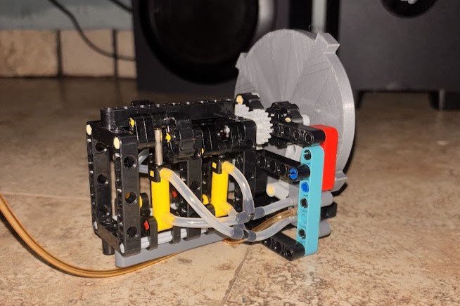
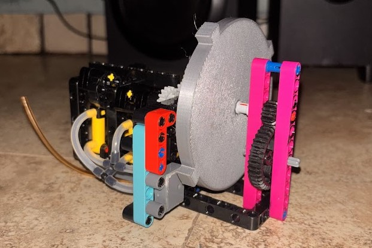
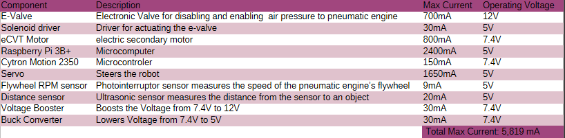
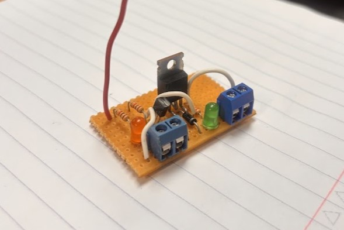

# World Robot Olympiad Future Engineers 2026
Welcome to our repository, we are a team from Puerto Rico that tackled for the first time the challenge of the WRO future engineers category, determined to bring a unique aproach to the competition.

All terms in the italic font are linked to the [***glossary***](Glossary.md).

# The Primis

### Team Members,  From Left to Right:

1. Joseph Macias Diaz
2. York E. jackobs Lopez **(Coach)**
3. Sebastian J. Parrilla
4. Carlos A. Espada Rivera

### [team history](team_history.md)
# Anti Insult Zapping Automaton (A.I.Z.A)
AIZA is our autonomous robot featuring an electropneumatic hybrid drivetrain and vision-based navigation developed for the **WRO Future Engineers 2026** competition.

<table>
  <tr>
    <td align="center">
      <b>Front View</b> 
      
    </td>
    <td align="center">
      <b>Rear View</b> 
      
    </td>
    <td align="center">
      <b>Left Side</b> 
      
    </td>
  </tr>
  <tr>
    <td align="center">
      <b>Right Side</b> 
      
    </td>
    <td align="center">
      <b>Top View</b> 
      
    </td>
    <td align="center">
      <b>Isometric View</b> 
      
    </td>
  </tr>
</table>

[**Click here to see past iterations of the robot**](development_process/vehicle_iterations)

Unlike a conventional electric drivetrain, AIZA uses a pneumatic engine
as its primary source of mechanical power. Multiple systems, like the Air Supply and Management System, sensor system and electrical system are used to control and monitor the drivetrain, while a **electronic continuously variable transmission** allows the pneumatic power to be adapted eficiently to the robot's operating demands and conditions.

### [The complete step by step guide to build your very own AIZA here.](build_guide)

## Performance videos
Open challenge:
[(Placeholder)]()

Obstacle challenge:
[(Placeholder)]()

# Systems Architecture

AIZA is divided into four main systems that work together as a single autonomous platform:

 **Mechanical System** - Converts pneumatic and electrical power into controlled and measured wheel motion through the drivetrain.

 **Air Supply and Management System** - Stores compressed air, regulates the pressure, and supplies the pneumatic engine.

 **Electrical System** - Provides power to the Raspberry Pi, Cytron Motion 2350, sensors, actuators, and the electric transmission motor.
 
 **Sensing and Control System** - Uses the camera, IMU, and encoders to determine the robot's position, orientation, and drivetrain state.

# Mechanical

### The Pneumatic Engine

Our robot uses a 4 piston, 2 crankshaft pneumatic engine. It has a flywheel that smoothes out how the engine spins with inertia, we made it with slots in order to count the interruptions per second with the Photointeruptor RPM sensor, which lets us know how hast its going.

<table>
  <tr>
    <td></td>
    <td></td>
  </tr>
  <tr>
    <td align="center">Front view</td>
    <td align="center">Back view</td>
  </tr>
</table>

### A.S.M.S (Air Supply and Management System)
 The ASMS is the system in charge of storing air pressure, regulating it to a lower pressure, then supplying it when necesary to the pneumatic engine.

 

</td>
</tr>
</table><table>
<tr>
<td width="50%" align="center">

</td>
<td width="60%" valign="top">

We store the compressed air in 6 lightweight tanks at 100psi of pressure, and join them all with silicone tubing and "T" adapters.

[why we used it and more details here.](mechanical\eCVT\README.md)
</td>
</tr>
</table>

### Safety measures in the ASMS

- 1/4 male to 1/8 female brass fitting max pressure of 1200psi
- NPT ¼ male to NPT1 1/8 male 1200psi
- NPT 1/8 male schrader valve 200psi
- Brass T fitting, 2 female 1/8, 1 male 1/8 1200psi
- Air Regulator max output 145psi
- e-valve max 115psi
- NPT 1/8 male 1/16 hose barb 120psi
- Robart Small air tank 110psi
- Robart 6ft tubing 1/16 ID 120psi

### The challenges of a pneumatic engine in a autonomous robot
A conventional electric drivetrain is simpler, more efficient, easier to control, and generally better suited for an autonomous competition robot than a penumatic engine. Rather than treating the disadvantages of pneumatic power as reasons to avoid it, we treated them as engineering challenges.

But we knew that the limitations of a pneumatic drivetrain were not necessarily limitations of the pneumatic engine alone, but of how the entire powertrain was designed around it.

<table>
<tr>
<th width="50%">Disadvantage</th>
<th width="50%">Our Approach</th>
</tr>

<tr>
<td>Hard to control the pneumatic engine's speed with a reliable, leak free, compact, and lightweight solution.</td>
<td>An eCVT allows you to keep the pneumatic engine on a fuel eficient speed while changing the speed of the robot with the secondary electric motor. </td>
</tr>

<tr>
<td>A system capable of continuously supplying compressed air to the pneumatic engine would be expensive, heavy, and consume valuable space on the robot.</td>
<td>Rather than supplying compressed air continuously, we designed the robot around stored compressed air using lightweight, high pressure tanks and a way to regulate the air, allowing the pneumatic engine to operate independently of an onboard compressor.</td>
</tr>

<tr>
<td> Pneumatic engine can only spin a certain direction, depending of how timing is set up.  </td>
<td>Instead of reversing the pneumatic engine, we designed the drivetrain so that reverse motion is handled electrically through the eCVT. This allows the pneumatic engine to remain optimized for forward operation while maintaining bidirectional control of the robot.</td>
</tr>

</table>

### The eCVT

</td>
</tr>
</table><table>
<tr>
<td width="50%" align="center">

</td>
<td width="60%" valign="top">

An [***eCVT***](glossary.md#ecvt) is a electronic continuosly variable transmission, a transmission that pairs two inputs in to a output, and with the proper combining of the inputs, a output with an infinite gear ratio is possible without the need of gear shifting. 

[why we used it and more details here.](mechanical\eCVT\README.md)
</td>
</tr>
</table>

</td>
</tr>
</table><table>
<tr>
<td width="50%" align="center">

</td>
<td width="60%" valign="top">

The second input for the eCVT is this, a makeblock 7.4V Motor with a built in encoder, this allows us to know precisely at what RPM its spining, which is escential in order to have the correct gear ratio.

[More on calculated gear ratios on software.]()

</td>
</tr>
</table>

# Electrical
- Diagram and component  verview, current calculations
- Safety 
- mosfet driver

Our robot's components need 3 different voltages.

- 7.4V - supplied by two 3.7V batteries in series.
- 5V - supplied by a buck converter that lowers the voltage from 7.4V to 5V
- 12V - supplied by the voltage booster  

### Max current calculations

The robot uses interchangeable 7.4 V battery packs with a nominal capacity of 3.5 Ah. Due to the robot's limited mass and available space, additional onboard battery capacity is not practical within the current design constraints. Instead, packs are swapped and recharged between runs.

### Solenoid Driver

Our ASMS uses a e-valve to opene or close the passage of air pressure to the pneumatic engine. To supply the 800mA and 12V it needs we needed to make a driver board for it.

</td>
</tr>
</table><table>
<tr>
<td width="50%" align="center">

</td>
<td width="60%" valign="top">

The solenoid driver uses a MOSFET in order to control a high current circuit with a small current circuit.

Since we used a MOSFET that wasnt logic level, we also used a gate driver, to fully close the MOSFET when the signal is HIGH

[More details here.](electrical/Cytron_Motion_2350_Pro/Solenoid_driver/README.md)

</td>
</tr>
</table>

# Strategy

#### Before Starting
Complying with the rules, the robot switches to ON with one switch, and initialices the program with one button, once the robot is powered, it initializes UART communication. The Cytron waits until the RaspberryPi boots and sends a "1" as a "ready" signal, after this the RaspberryPi waits until we initialize the program with one of the on-board buttons of the Cytron, when pressed, the Cytron sends a "1" as a "Start" command, which inicializes the vision program, and resets the yaw angle to 0.

#### Navigation State Machine
The robot's IMX708 camera detects line colors and wall boundries, we use this to determine how far the blue or orange line are and which comes first, since its a queue for what direction the robot should go. 

#### Speed State Machine
Depending on the Navigation State Machine value, the RaspberryPi will send the Cytron a speed value of 1-7, using the electric motor encoder and pneumatic engine flywheel encoder the Cytron calculates the correct gear ratio to move the at the speed the RaspberryPi is commanding.

#### After Starting
 After the Cytron sends the start command to the RaspberryPi, the robot goes forward, the camera logic traces a line from the bottom center of the image until it reaches a blue or orange line, it will record the first line that it encounters and keeps track of the distance in pixels with how long the line is, when the line length in pixels is less than 50 pixels, it saves  the yaw angle and then turns, when the yaw angle is more than 90 it recenters and then keeps going straight, then we repeat that 11 times to complete the open challenge.

# Software and Sensors
 Our robot has two brains, a Cytron Motion 2350 Pro and a Raspberry Pi 3B+, they both operate different parts of the robot.

Codes used in each board for the WRO 2026 final is linked.

 ## Raspberry Pi 3B+

 [Raspberry pi code]()

 The RaspberryPi is responsable for taking desitions based on what the [IMX708 camera]() sees, it sends via UART direction, Speed, and a "Ready" variable.

 ## Cytron Motion 2350 Pro
 [Cytron code]()

 The Cytron is reasponsable with giving the RaspberryPi the IMU and distance sensor values, and also sends a "Ready' variable.

 The main task the Cytron has is transmission logic. Based on at what speed the Raspberry pi is commanding it to go, it has to look at the RPM reading from the Pneumatic engine's flywheel using the **Photointrruptor sensor** ([more on it's code here]()) to adjust the electric motor precisely to a target RPM measured by the **electric motor's encoder sensor** ([more on it's code here]()), to achieve the correct gear ratio, 

More on how the software calculates the gear correct ratio [here]().

