# World Robot Olympiad Future Engineers 2026
Welcome to our repository, we are a team from Puerto Rico that tackled for the first time the challenge of the WRO future engineers category, determined to bring a unique aproach to the competition.

All terms in the italic font are linked to the [*glossary*](Glossary.md).

# The Primis

### Team Members,  From Left to Right:

1. Joseph Macias Diaz
2. York E. jackobs Lopez **(Coach)**
3. Sebastian J. Parrilla
4. Carlos A. Espada Rivera

### [team history](team_history.md)

#  Mobility and Mechanical Design

### Anti Insult Zapping Automaton (A.I.Z.A)
AIZA is our autonomous robot featuring an [*electropneumatic*](Glossary.md) hybrid [*drivetrain*](Glossary.md) and [*vision-based navigation*](Glossary.md) developed for the **WRO Future Engineers 2026** competition.

<table>
  <tr>
    <td align="center">
      <b>Front View</b> 
      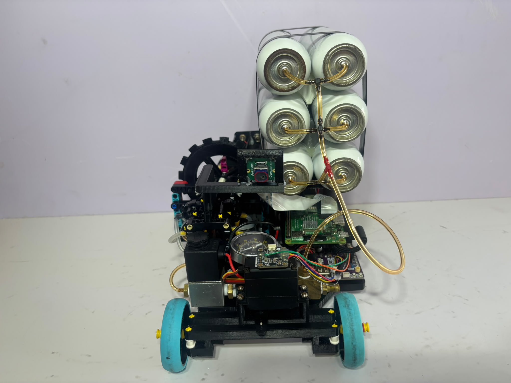
    </td>
    <td align="center">
      <b>Rear View</b> 
      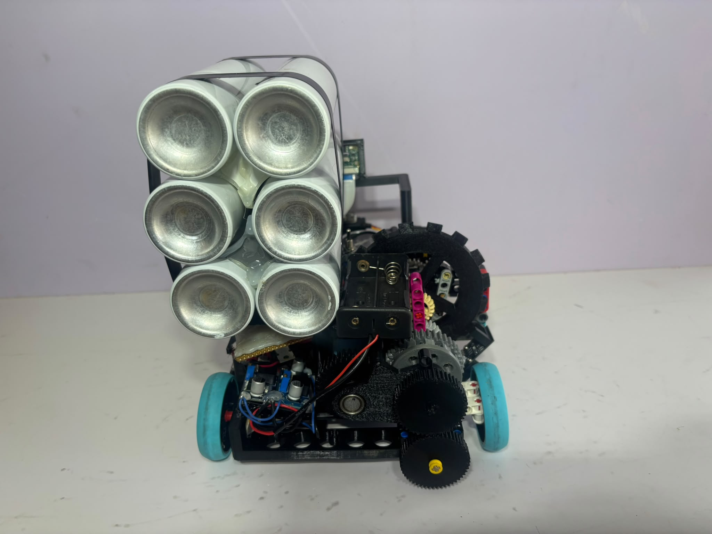
    </td>
    <td align="center">
      <b>Left Side</b> 
      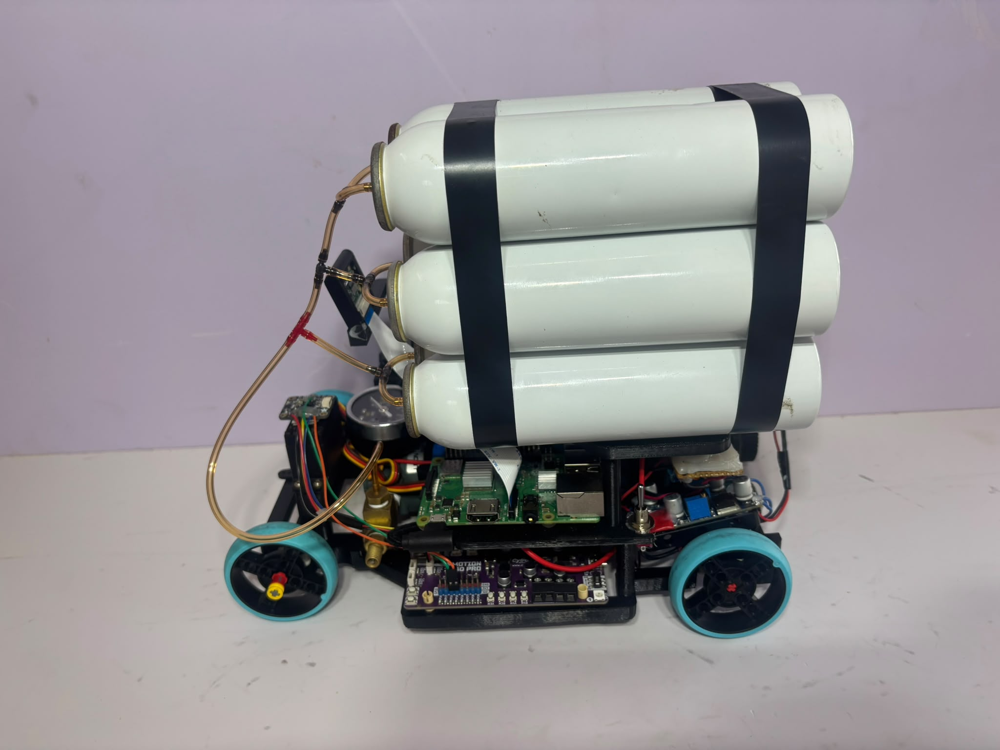
    </td>
  </tr>
  <tr>
    <td align="center">
      <b>Right Side</b> 
      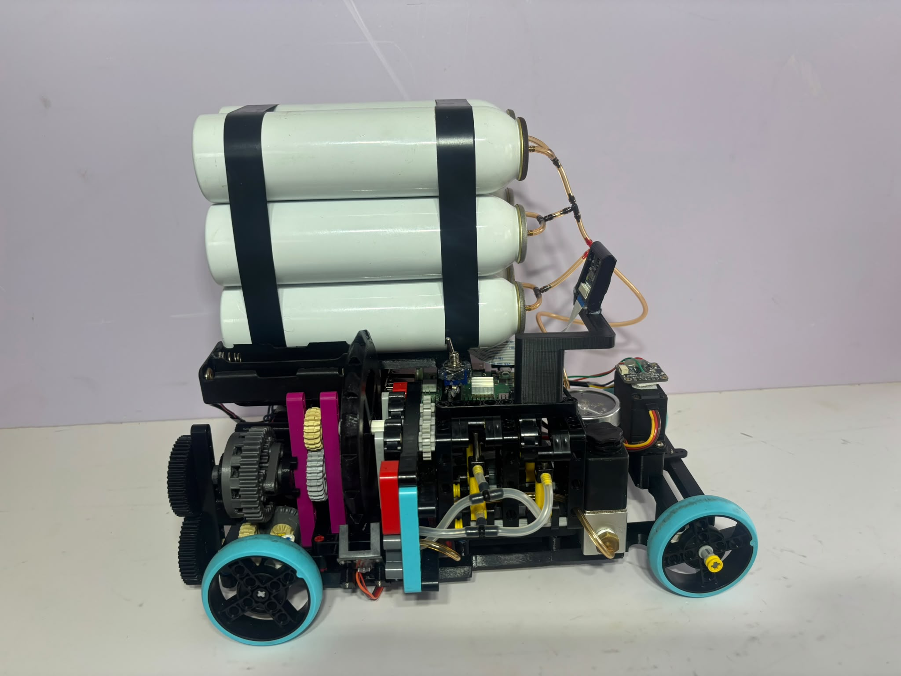
    </td>
    <td align="center">
      <b>Top View</b> 
      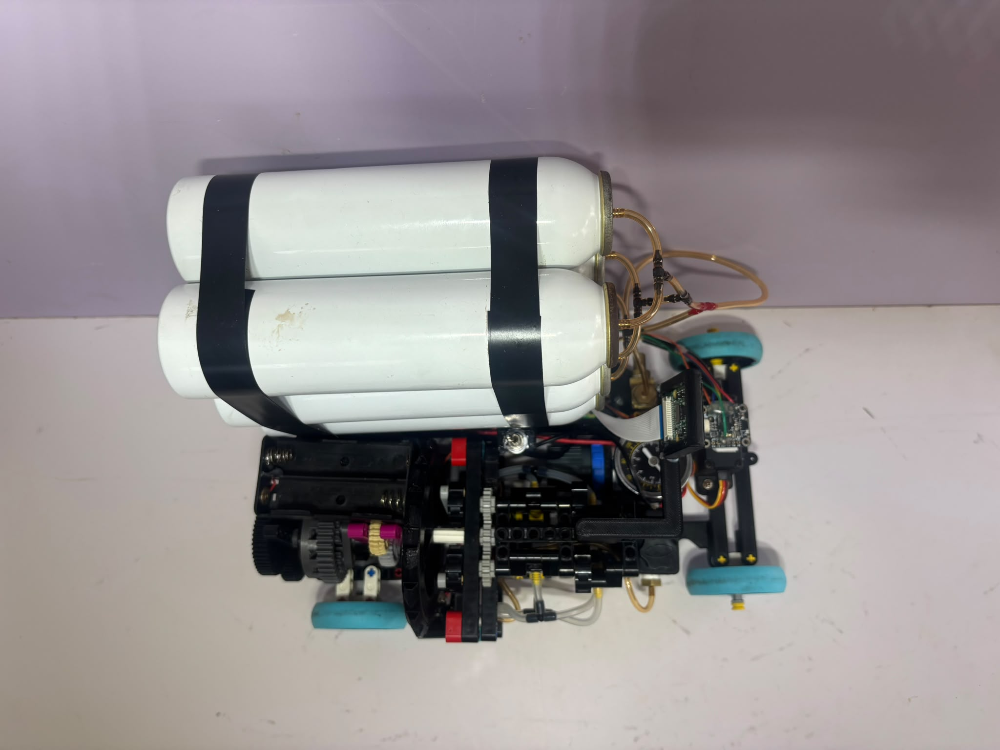
    </td>
    <td align="center">
      <b>Bottom view</b> 
      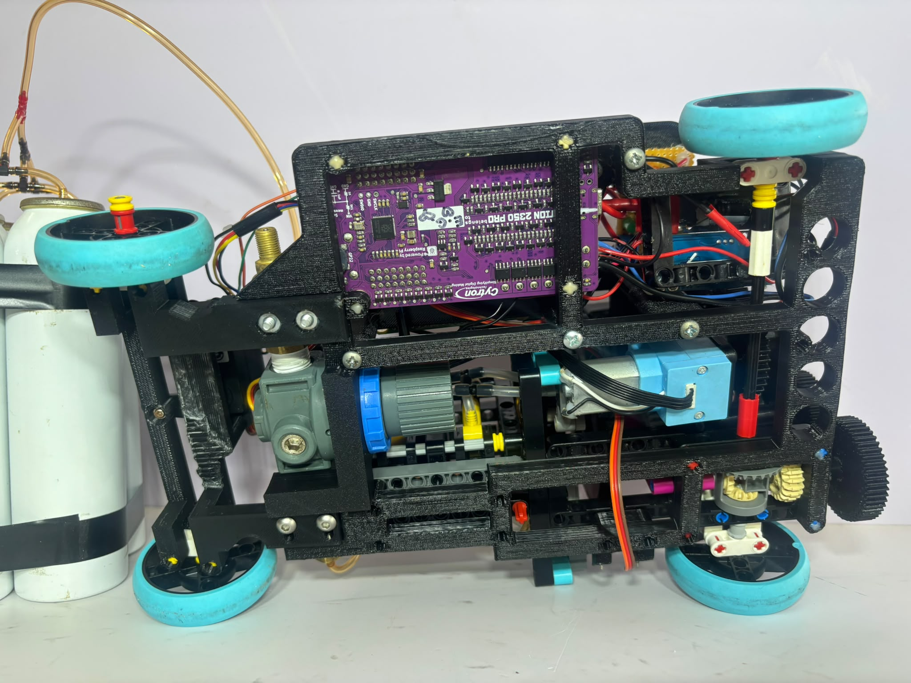
    </td>
  </tr>
</table>

### [Click here to see past iterations of the robot](development_process/vehicle_iterations)

### [ALL CAD files](media/CAD/STL/Air_tanks_Base_3.stl)

### Performance video

[Open challenge](https://youtu.be/QNBB8k_d7_M)

### WRO code

[**Cytron**](code/Cytron_2350)

[**RaspberryPI**](code/RaspberryPi)

Unlike a conventional electric drivetrain, AIZA uses a [*pneumatic engine*](Glossary.md) as its primary source of [*mechanical power*](Glossary.md). Multiple systems, like the [*Air Supply and Management System*](Glossary.md) (ASMS), sensor system and electrical system are used to control and monitor the drivetrain, while a [*electronic continuously variable transmission*](Glossary.md) (eCVT), allows the pneumatic engine's power to be adapted eficiently to the robot's operating demands and conditions.

<table>
  <tr>
    <td width="60%" valign="top">
      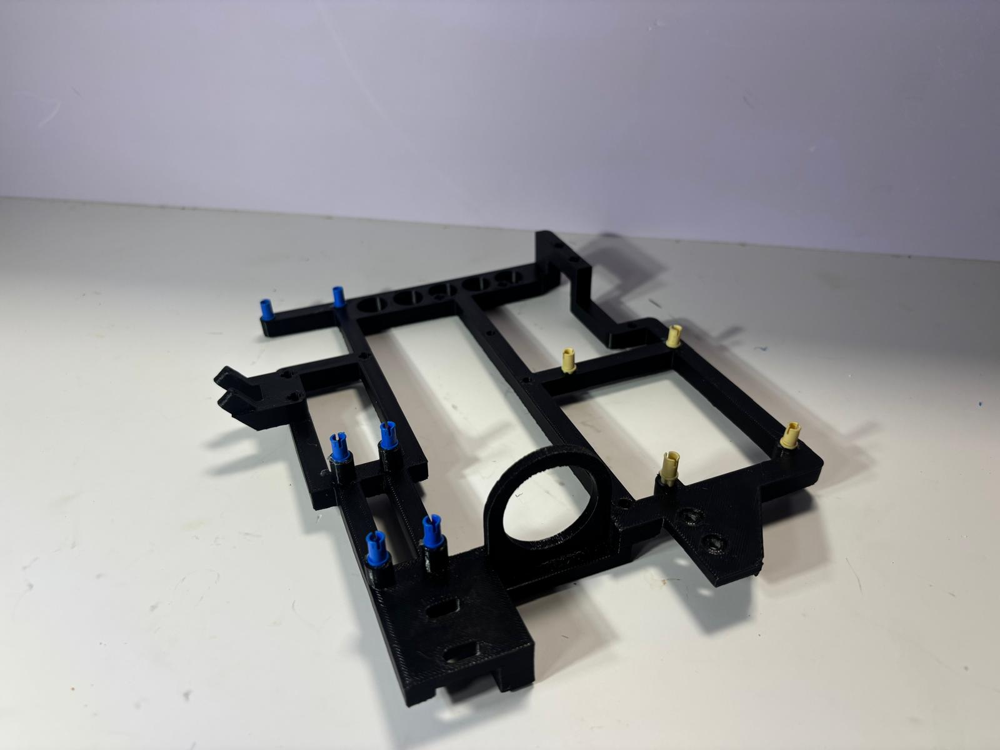
    </td>
    <td width="60%" valign="top">
      <h3>Chassis</h3>
      

        AIZA's Chassis is the fourth iteration, components are printed in PETG since we needed a sturdy, reliable chassis for heavy and big systems. 

[more info, and design trade-offs here](mechanical/Chassis.md)
      

    </td>
  </tr>
    <tr>
    <td width="60%" valign="top">
      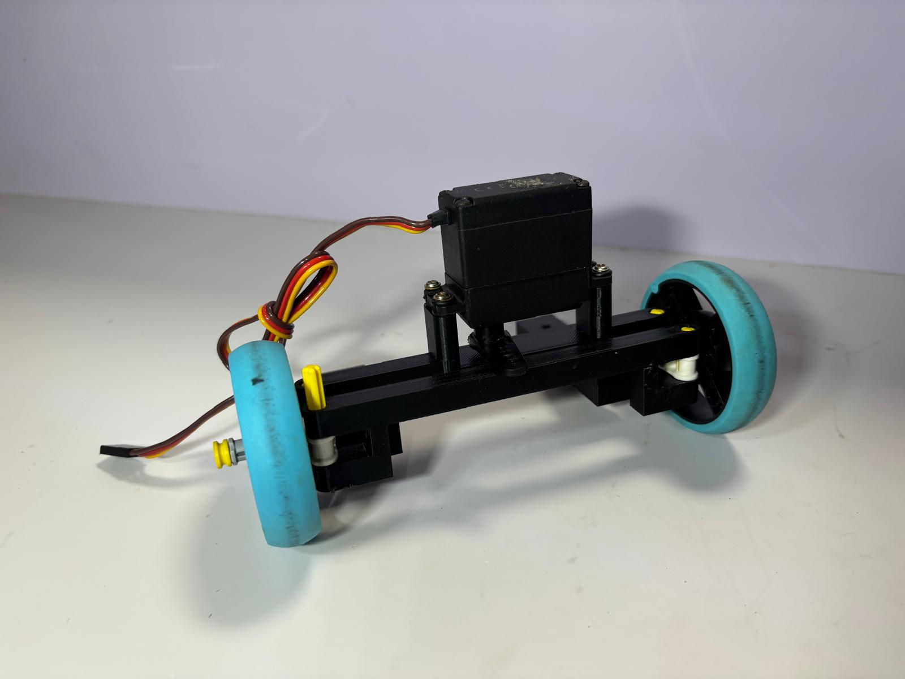
    </td>
    <td width=60%" valign="top">
      <h3>Steering</h3>
      

        We used a parallel steering geometry, we knew we needed a robust system since we knew from the start the robot was going to be heavy and big, it had to be made separate from the chassis since our printer didn't have enough space to print the full chassis.

[More info and design trade-offs here](mechanical/Steering.md)
      

    </td>
</table>

### The Pneumatic Engine

Our robot uses a 4 piston, 2 [*crankshaft*](Glossary.md) pneumatic engine. It has a [*flywheel*](Glossary.md) that smoothes out how the engine spins with [*inertia*](Glossary.md), we made it with slots in order to count the interruptions per second with the [*Photointeruptor*](Glossary.md) RPM sensor, which lets us know how fast its going **(more on that later)**.

[**Click here to understand engine fundamentals**](mechanical/Pneumatics/Penumatic_Engine/README.md)

[**Click here to see past iterations of the engine**](mechanical/Pneumatics/Penumatic_Engine)

<table>
  <tr>
    <td></td>
    <td></td>
  </tr>
  <tr>
    <td align="center">Front view</td>
    <td align="center">Back view</td>
  </tr>
</table>

From the output of the flwyheel, to the output of the pneumatic engine we used a 1.4:1 gear ratio, [**click here to see why we chose this**](development_process/tests/engine_output_ratios.md).

### A.S.M.S (Air Supply and Management System)
The ASMS stores compressed air in a tank assembly with a combined internal [*displacement*](Glossary.md) of 1,422 cm³, charged to 100 [*psi*](Glossary.md). A pressure regulator reduces the stored air pressure to a nominal operating pressure of 20 psi before supplying the pneumatic engine. Storing the air at a higher pressure was escential for a longer runtime [click here to see how we tested that](development_process/tests/air_supply_duration_calculations.md).

 A normally closed, electronic valve controls air delivery to the engine, remaining closed until electrically energized by the robot's control system.

 

ASMS FLOWCHART

</td>
</tr>
</table><table>
<tr>
<td width="50%" align="center">

</td>
<td width="60%" valign="top">

We store the compressed air in 6 lightweight tanks at 100psi of pressure, and join them all with silicone tubing and "T" adapters.

[why we used it and more details here.](mechanical/Pneumatics/ASMS/Airtanks.md)
</td>
</tr>
</table>

</td>
</tr>
</table><table>
<tr>
<td width="50%" align="center">

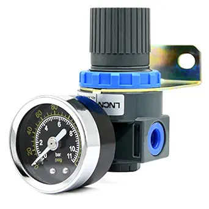

</td>
<td width="60%" valign="top">

The regulator allows you to control the maximum pressure that is going to come out of the outlet, this lets us have a high pressure side and a adjustable low pressure side.

[why we used it and more details here.](mechanical/Pneumatics/ASMS/Air_regulator.md)
</td>
</tr>
</table>

</td>
</tr>
</table><table>
<tr>
<td width="50%" align="center">

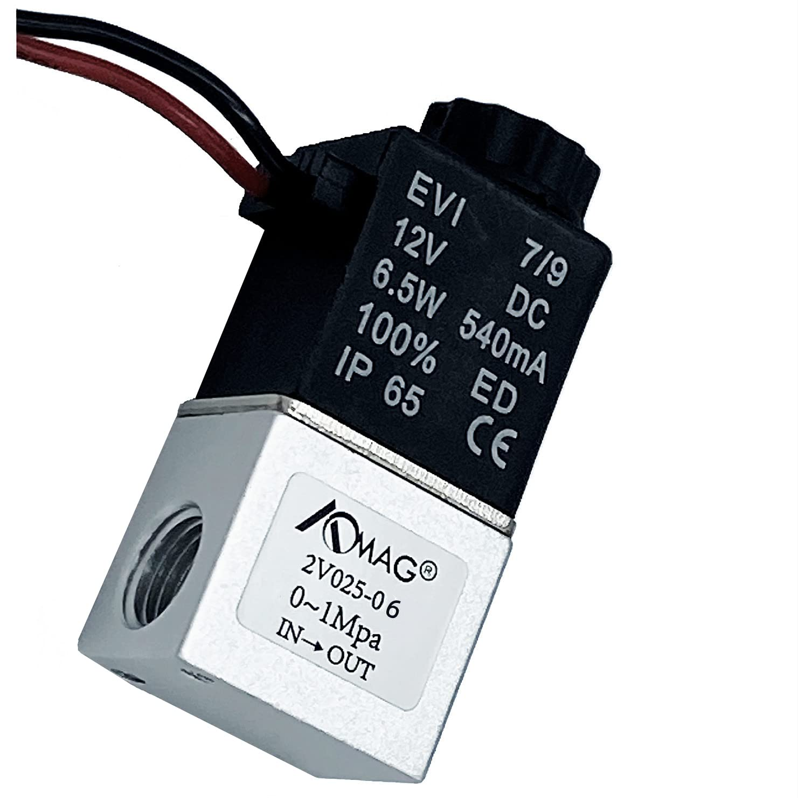

</td>
<td width="60%" valign="top">

This component is a normally closed valve that uses a solenoid to open or close the passage of compressed air to the pneumatic engine, allowing us to control wether its ON/OFF.

[why we used it and more details here.](electrical/e-valve.md)
</td>
</tr>
</table>

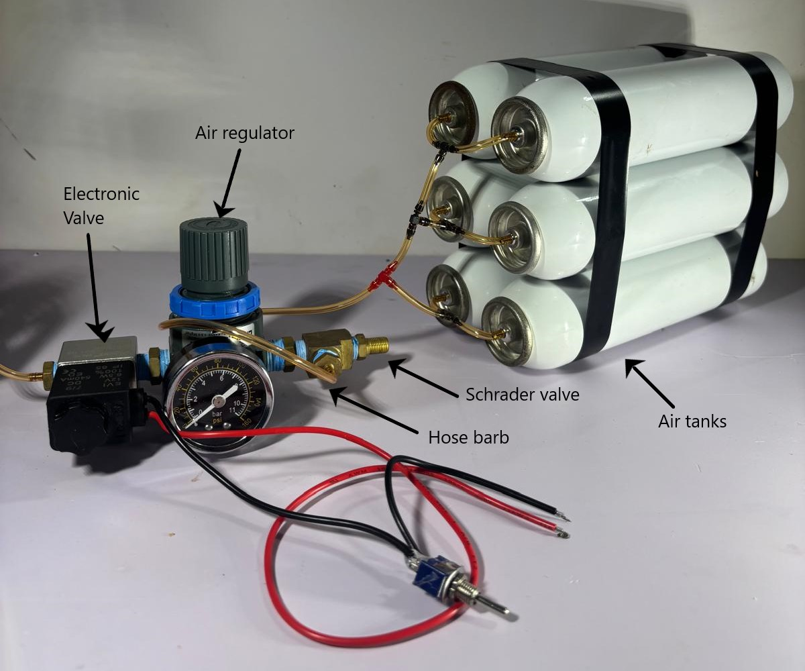

### AIZA's Transmission, the eCVT 5.1

</td>
</tr>
</table><table>
<tr>
<td width="50%" align="center">

</td>
<td width="60%" valign="top">

An **eCVT** is a electronic continuosly variable transmission, a transmission that pairs two inputs in to a output, and with the proper combining of the inputs, a output with an infinite [*gear ratio*](Glossary.md) is possible without the need of gear shifting. 

[Click here to see why we used it and some trade-offs that come with using it.](mechanical/eCVT/README.md)

[See the past iterations of the eCVT!](mechanical/eCVT)
</td>
</tr>
</table>

</td>
</tr>
</table><table>
<tr>
<td width="50%" align="center">

</td>
<td width="60%" valign="top">

The second input for the eCVT is this, a makeblock 7.4V Motor with a built in encoder, this allows us to know precisely at what RPM its spining, which is escential for eCVT logic.

[More on calculated gear ratios on software.](development_process/tests/engine_output_ratios.md)

</td>
</tr>
</table>

### Transmission Ouput

</td>
</tr>
</table><table>
<tr>
<td width="60%" align="center">

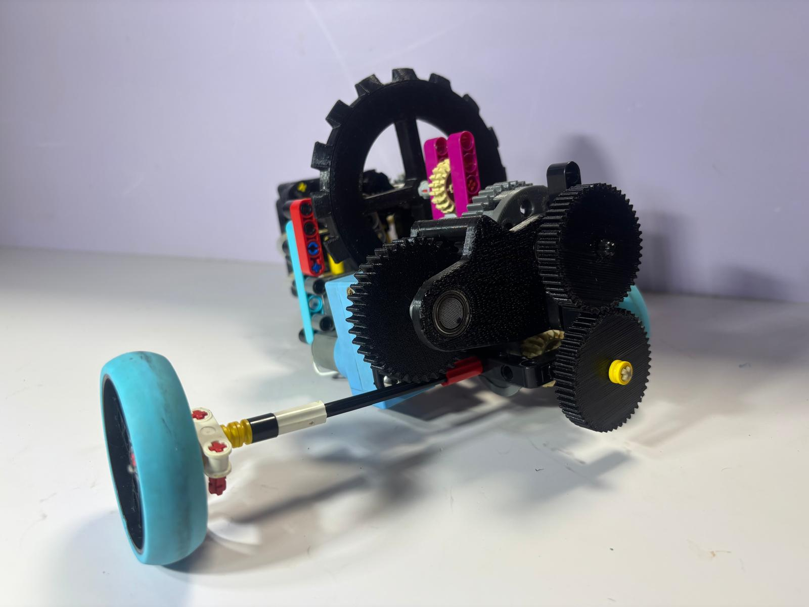

</td>
<td width="40%" valign="top">

The eCVT's output is then connected to a Lego diferential linked by a 1:1 gear ratio this is escential for accurate turns. This makes AIZA rear wheel drive. 

[See every gear ratio in our robot here](development_process/tests/engine_output_ratios.md)

</td>
</tr>
</table>

# Our custom Dynamometer: Torque and Power Specs

Since one of the best features of our custom eCVT is the ability to keep the pneumatic engine on a fuel eficient speed while changing the speed of the robot with the secondary electric motor, we needed to know which was the most eficient speed of the pneumatic engine.

We built a custom dynamometer to measure the engine's [*torque*](Glossary.md), [*rotational speed*](Glossary.md), and [*horsepower*](Glossary.md) at different regulator operating pressures. This allowed us to evaluate the trade-off between engine performance and air consumption.

 

<table>
  <tr>
    <td width="40%" valign="top">
      
    </td>
    <td width="60%" valign="top">
      <h3>Max Torque</h3>
      

        A load cell measures the reaction force generated by the
        braking mechanism, allowing torque to be calculated.
      

    </td>
  </tr>
    <tr>
    <td width="40%" valign="top">
      
    </td>
    <td width="60%" valign="top">
      <h3>Max RPM</h3>
      

        An optical sensor tracks the engine's rotational speed
        throughout the testing process.
      

    </td>
  <tr>
    <td width="60%" valign="top">
      
    </td>
    <td width="40%" valign="top">
      <h3>Max Power</h3>
      

        With the calculated torque, and the RPM of the engine, we calculated the power.
      

    </td>
  </tr>
  </tr>
    <tr>
    <td width="60%" valign="top">
      
    </td>
    <td width="40%" valign="top">
      <h3>Operation Duration</h3>
      

        This chart represents how the air supply duration is affected by the operating air pressure.
      

    </td>
    
  </tr>
</table>

### Selecting the optimal operating pressure

| Pressure | Advantages | Disadvantages | Trade-off |
|---|---|---|---|
| **15 PSI** | Low air consumption | Low rotational speed, torque and power could not be measured | Greater potential endurance, but very limited performance |
| **20 PSI** | Measurable torque and power moderate operating pressure | Lower maximum output than higher-pressure settings | Sacrifices peak performance in favor of a more longer runtime |
| **25 PSI** | Higher torque, power, and speed than at 20 PSI | Greater air consumption and reduced runtime | Improved performance at the expense of air endurance |
| **30 PSI** | Highest measured torque, power, and rotational speed | Higher air consumption and shorter runtime | Maximizes instantaneous performance rather than endurance |

### Selected operating pressure: **20 PSI**

Although 30 PSI provided the highest measured power output, we selected 20 PSI to prioritize air endurance over maximum instantaneous performance. This provides a compromise between mechanical output and the available compressed-air supply.
The data shows a fairly clear trend: increasing pressure improves the pneumatic engine's performance, but it comes at the cost of operating duration. That's a  trade-off to discuss because we're not simply trying to maximize power, we're balancing performance against available stored energy.

### Dyno results at 20psi

|  | 20 PSI |
|---|---|
| Maximum Torque | 0.015 N·m |
| Maximum Power | 0.0002 HP |
| Maximum Speed | 304 RPM |
| No-Load Runtime | 50 s |

### [The full dynamometer test documentation here](development_process/tests/DYNAMOMETER.md)

# Power and Sensor Architecture

AIZA is divided into four main systems that work together as a single autonomous platform:

 **Mechanical System** - Converts pneumatic and electrical power into controlled and measured wheel motion through the drivetrain.

 **Air Supply and Management System** - Stores compressed air, [*regulates*](Glossary.md) the pressure, and supplies the pneumatic engine.

 **Electrical System** - Provides power to the Raspberry Pi, Cytron Motion 2350, sensors and the electric transmission motor.
 
 **Sensing and Control System** - Uses the camera, [*IMU*](Glossary.md), and [*encoders*](Glossary.md) to determine the robot's position, orientation, and drivetrain state.

## AIZA's sensors

| Sensor | Why We Chose It | Calibration andting Method |
|---|---|---|
| **IMX708 Camera** | Its 120° field of view provides a wider view of the competition field than the OV5647's 56° field of view. [See here why we chose the IMX](development_process/logs/OVvsIMX.md) | HSV thresholds were established by sampling colors through the actual camera under the available lighting conditions instead of relying exclusively on official field color values. This accounts for differences in lighting and camera color response. [See here for more info](development_process/tests/matthreshholddetecting.md)|
| **BNO085 IMU** | Provides orientation and yaw measurements used for turning and heading correction. Its onboard sensor fusion provides orientation data without requiring us to combine multiple separate sensors. | We compare an initial value and substract it by that amount, that gives us a value starting from 0 for the rest of the laps, since the sensor used multiple reading in to one, we havent had problems with drift. [See here the Cytron's code to see how we calibrated the samples.](code/Cytron_2350/mainopen.py) |
| **Ultrasonic Distance Sensor** | Provides distance measurements for detecting nearby obstacles. It offers a straightforward way to measure distance without relying on camera-based detection. | Using the library of the sensor, we checked to see if readings were accurate with a ruler. |
| **Flywheel Photointerrupter** | Measures the pneumatic engine's flywheel RPM using an optical sensor and a slotted encoder disk. We chose it over a Hall-effect sensor because it is lighter, cheaper, and does not require a metal target or magnet. [See why we chose the photointerruptor](development_process/logs/Hallvsoptic.md) | The flywheel disk uses 16 slots per revolution. RPM is calculated from the time between pulses. To reduce measurement fluctuations, the program stores seven time intervals in a rolling sample queue and averages them before calculating RPM. [Flywheel RPM sensor development](development_process/tests/Flywheelencoder.md) |
| **eCVT Motor Encoder** |Since we needed to know the electric motor's sped as well, it was better to have a electric motor with an intgrated one rather than a separate flywheel for a second photointerruptor.| We made a rig to calibrate both encoders, we set both in the same axle and found that both were the same reading and consistant, [see the test here.](development_process/tests/eCVTlogiccoding.md) |

## Sensor Placements

### Camera Placement and Field Geometry

The IMX708 camera is mounted 150mm above the ground, with a 15° downward inclination from the horizontal plane.

The WRO competition field is 3,000 mm long. With the camera mounted at this height and angle, its central viewing axis intersects the ground approximately 568 mm ahead of the robot. This corresponds to roughly 19% of the field's total length, providing visibility of the ground ahead while maintaining a forward-looking perspective.

The camera's 120° diagonal field of view further expands the visible area, allowing the vision system to observe field markings and boundaries across a wider portion of the surroundings. This is important because the robot must perceive its position relative to the field geometry while moving and approaching turns.

| Parameter | Value |
|---|---:|
| Camera | IMX708 |
| Mounting height | 150mm |
| Downward inclination | 15° |
| Diagonal field of view | 120° |
| Field length | 3,000 mm |
| Centerline ground intersection | 568.3 mm |
| Percentage of field length | 18.9% |

### Photointerrupter Placement

</td>
</tr>
</table><table>
<tr>
<td width="50%" align="center">

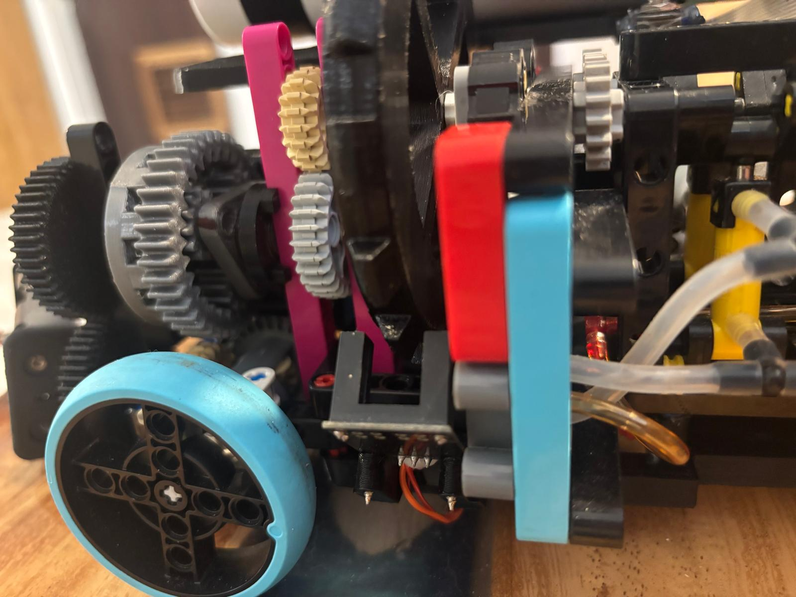

</td>
<td width="50%" valign="top">

The photointerrupter is positioned adjacent to the pneumatic engine's flywheel, aligned with the rotating encoder disc so that its teeth periodically interrupt the sensor's infrared beam.

The sensor must maintain sufficient clearance from the disc to prevent physical contact during rotation. Initially, we used an encoder disc with rectangular teeth, but flywheel wobbling occasionally caused the teeth to catch against the photointerrupter. We redesigned the disc with sharper, tapered teeth to improve clearance and reduce the risk of mechanical interference.

This placement allows the controller to reliably detect the 16 slots per revolution and calculate the flywheel's RPM. 

</td>
</tr>
</table>

### Voltage Regulation

AIZA's electrical components require three different voltage levels. Instead of powering every component directly from the battery, we use voltage conversion to provide the required supply rails.

| Voltage rail | Source | Purpose |
|---|---|---|
| 7.4 V | Two 3.7 V cells connected in series | Main battery supply and components operating at battery voltage |
| 5 V | Buck converter stepping down from 7.4 V | Raspberry Pi and 5 V electronics |
| 12 V | Voltage booster stepping up from 7.4 V | Solenoid valve |

The voltage regulators are shown below.

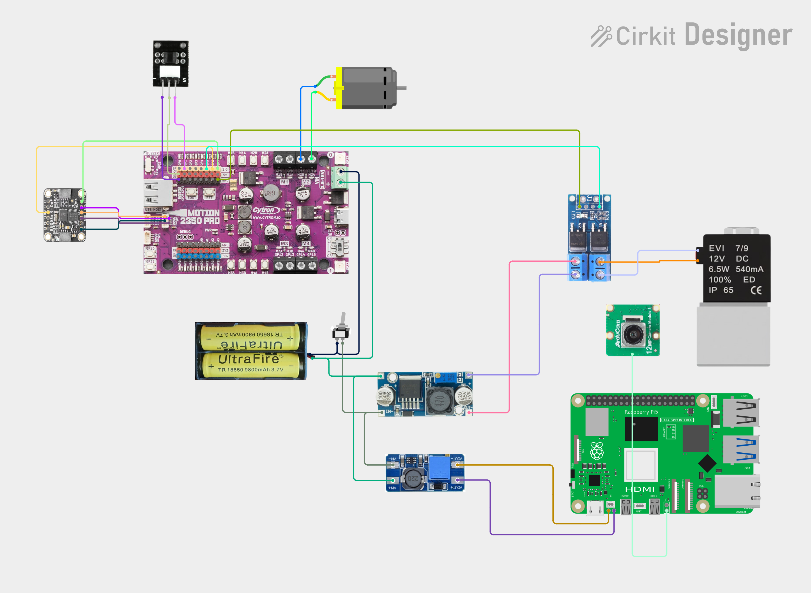

### Max current calculations

### Max Power Calculations
| Component | Operating Voltage (V) | Maximum Current (A) | Maximum Power (W) |
|---|---:|---:|---:|
| E-Valve | 12 | 0.700 | 8.400 |
| Solenoid Driver | 5 | 0.030 | 0.150 |
| eCVT Motor | 7.4 | 0.800 | 5.920 |
| Raspberry Pi 3B+ | 5 | 2.400 | 12.000 |
| Cytron Motion 2350 | 7.4 | 0.150 | 1.110 |
| Servo | 5 | 1.650 | 8.250 |
| Flywheel RPM Sensor | 5 | 0.009 | 0.045 |
| Distance Sensor | 5 | 0.020 | 0.100 |
| Voltage Booster | 7.4 | 0.030 | 0.222 |
| Buck Converter | 7.4 | 0.030 | 0.222 |
| **Total** | — | — | **36.419 W** |

### Solenoid Driver

Our ASMS uses a e-valve to open or close the passage of air pressure to the pneumatic engine. To supply the 800mA and 12V it needs we needed to make a driver board for it.

</td>
</tr>
</table><table>
<tr>
<td width="50%" align="center">

</td>
<td width="60%" valign="top">

The solenoid driver uses a MOSFET in order to control a high current circuit with a small current circuit.

Since we used a MOSFET that wasnt logic level, we also used a gate driver, to fully close the MOSFET when the signal is HIGH, two LED to indicate the state and a diode for safety purposes.

[More details here.](electrical/Solenoid_driver.md)

</td>
</tr>
</table>

The Mosfet driver Circuit electrical diagram.

# Software Architecture and Obstacle Challenge Strategy

AIZA uses two controllers, a **Cytron Motion 2350 Pro** and a **Raspberry Pi 3B+**, each responsible for a different part of the robot's operation. This separation allows the Raspberry Pi to handle computationally intensive vision processing while the Cytron manages real-time drivetrain control, sensor acquisition, and actuators.

The two controllers communicate through a [*UART*](Glossary.md) connection. The Raspberry Pi processes camera information and determines the robot's navigation commands, while the Cytron handles the drivetrain response using feedback from the IMU, distance sensor, and rotary encoders.

| Controller | Main responsibilities |
|---|---|
| Raspberry Pi 3B+ | Camera image processing, navigation decisions, and sending movement commands |
| Cytron Motion 2350 Pro | Transmission control, motor actuation, RPM measurement, IMU and distance sensor readings, and communication with the Raspberry Pi |

### UART Communication

The Raspberry Pi and Cytron exchange information through a 3.3 V UART connection. This allows the Raspberry Pi to send movement commands while receiving sensor information from the Cytron.

Both boards send 3 variables:
| Cytron | Raspberry |
|---|---|
| START | READY |
| IMU "YAW" | SPEED |
| DISTANCE | SERVO |

[See the UART test log here](development_process/tests/UART.md)

## Cytron Motion 2350 Pro

The Cytron is responsible for the drivetrain's low-level control and sensor acquisition. It reads the IMU and distance sensor and communicates their measurements to the Raspberry Pi. It also handles the startup handshake between both controllers.

### eCVT Control Logic

The transmission has two inputs: the pneumatic engine and an electric motor. The pneumatic engine's rotational speed is measured using a photointerrupter sensor positioned next to the slotted flywheel. The electric motor has an integrated encoder that provides feedback about its rotational speed.

The Cytron uses these measurements to regulate the electric motor toward a target RPM. The target depends on the movement command received from the Raspberry Pi.

By controlling the electric input relative to the pneumatic engine's speed, the controller changes the combined output of the [*planetary transmission*](Glossary.md). This allows the robot's wheel speed to be controlled while maintaining a fuel efficient speed on the pneumatic engine.

[See the proof of concept here.](development_process/tests/eCVTlogiccoding.md)

### Pneumatic Engine RPM Measurement

In order for the eCVT logic to work we need a reliable way of knowing both input's speeds, we measured the pneumatic engine's speed using a photointerrupter and a slotted disk attached to the flywheel.

Every time a slot passes through the sensor, the optical path is interrupted, producing a pulse. The Cytron measures the time between consecutive pulses and uses the known number of slots per revolution to calculate RPM.

[Flywheel RPM sensor development](development_process/tests/Flywheelencoder.md)

### Math in the eCVT logic

In order to have a controlable eCVT transmission you need to know evry gear ratio on the transmission, for acurate calculations.

- Crankshaft → Engine output: **1:1**
- Flywheel → Transmission input: **1:4**
- V5.0 Transmission: **1:8.4**
- Differential: **1.4:1**

The transmission and differential therefore provided a total 
reduction of:

8.4 x 1.4 x 1.4 = 16.464

[See all about gear ratios here](development_process/tests/engine_output_ratios.md)

## Raspberry Pi 3B+

The Raspberry Pi is responsible for vision processing and high-level navigation decisions. It receives images from the IMX708 camera, processes the field markings, and determines the direction and speed commands required to navigate the competition field.

The Raspberry Pi sends the Cytron the movement commands through UART, including direction and speed information. It also participates in the startup handshake.

### Camera and Image Processing

The IMX708 camera captures images at 2304 × 1296 pixels, while the preview is displayed at 640 × 360 pixels to reduce the processing required for visualization.The image-processing pipeline was developed to identify the boundaries of the drivable field and the colored lines used for navigation.

The main processing stages are:

- Field segmentation: Convert the image to grayscale and apply a threshold to distinguish the white drivable area from the black surrounding boundaries.
- Contour extraction: Use OpenCV **contour** detection to identify the field's outline.
- Boundary processing: Identify useful black-to-white transitions and approximate the field boundaries using contour processing and OpenCV **line fitting**.
- Color detection:Convert the filtered image to [*HSV*](Glossary.md) and apply color thresholds to isolate the blue and orange lines.
- Navigation input:Use the detected markings and their positions in the image to determine the next navigation action.

[Click here to see more details](development_process/tests/matthreshholddetecting.md)

The HSV thresholds were **Calibrated** by sampling the colors as they appeared through the actual camera, rather than relying exclusively on the official field color values. This was important because camera readings can vary with lighting conditions. 

### Modules and Functions

[Click here to see the code we used and all the functions/modules we used.](media/srs/checkcolorindisplay.py)

## Obstacle strategy 

### Startup and Handshake

1. `[PI: BOOTING | CYTRON: BOOTING]`
   - To start a match, we place the robot on the field and power it on using the main cutoff switch, while keeping the Cytron's onboard power switch permanently on. This allows us to use a single main power switch and the start button as the two operator controls.

2. `[PI: BOOTING | CYTRON: IDLE]`
   - The Cytron boots almost immediately and begins transmitting a `"READY"` variable to the Raspberry Pi.
   - While waiting for the Pi, the Cytron keeps its onboard LEDs red to indicate that the system is not yet fully ready.

3. `[PI: HANDSHAKE | CYTRON: READY]`
   - Once the Raspberry Pi finishes booting and receives the Cytron's `"READY"` message, it sends its own `"READY"` message back.
   - After receiving this response, the Cytron changes its onboard LEDs to green, indicating that both controllers have established communication and are ready to start.

4. `[PI: WAITING FOR START | CYTRON: WAITING FOR BUTTON]`
   - Both controllers remain in their waiting states until the user presses the start button connected to GP20 on the Cytron.
   - The Cytron then transmits a `"START"` message to the Raspberry Pi.
   - All motion commands remain at zero before the start signal is received. This prevents the robot from moving or performing sensor calibration before the match begins.

### Program Start

1. `[PI: PROGRAM START | CYTRON: OBEYING]`
   - After receiving `"START"`, the Cytron changes its onboard LEDs to yellow, indicating that the program is running.
   - The Raspberry Pi begins transmitting three control variables: `"SPEED"`, `"SERVO"` and `"READY"`.
   - The Cytron follows the received `"SERVO"` command directly, while `"SPEED"` becomes the target value used by the eCVT control logic to regulate the drivetrain.
   - At startup, the Cytron reads the BNO085 yaw value and stores it as the reference heading. Subsequent yaw measurements are compared against this reference, allowing the robot to measure its relative rotation from the starting orientation.

### Challenge Identification — OBSTACLE_MASK

1. `[PI: CHALLENGE DETECTION | CYTRON: OBEYING]`
   - The Raspberry Pi processes the camera image and applies the `OBSTACLE_MASK` to isolate regions that may correspond to obstacles.
   - OpenCV contour detection is used to identify connected regions, or blobs, within the mask.
   - Small contours are filtered out using a minimum area threshold to reduce false detections caused by image noise, reflections or small visual artifacts.
   - The remaining blobs are evaluated using their area, position and bounding-box dimensions to determine whether a valid obstacle-like object is present.
   - If no valid blobs are detected, the robot identifies the field as an Open Challenge environment and proceeds to line detection.
   - If valid blobs are detected, the robot identifies the presence of obstacles and proceeds to the corresponding obstacle-navigation logic.

### What Color Is FIRSTLINE?

1. `[PI: FIRSTLINE DETECTION | CYTRON: OBEYING]`
   - The Raspberry Pi identifies the first colored line detected by the camera and stores its color in the `FIRSTLINE` variable.
   - The distance between the detected line and the robot is measured in pixels.

   **If `FIRSTLINE = BLUE`:**
   - Servo commands are positive.
   - The reference yaw direction is positive.
   - The robot follows a counter-clockwise route.

   **If `FIRSTLINE = ORANGE`:**
   - Servo commands are negative.
   - The reference yaw direction is negative.
   - The robot follows a clockwise route.

   - Once the line reaches a predefined pixel-distance threshold, the Raspberry Pi stores the current yaw reference and sends the appropriate steering command according to the detected line color.
   - The robot continues forward until the relative yaw reaches the target angle.
   - Once the turn is completed, the Raspberry Pi commands the steering servo to return to its straight position and increments the `LAP` counter.
   - This process repeats until `LAP = 12`.

## Visual representation of the code

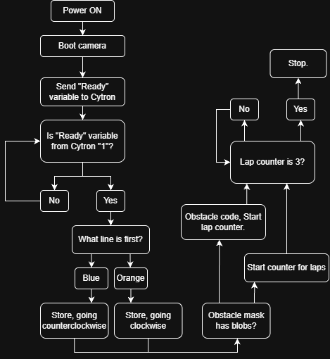

# Systems Thinking and Engineering Decisions

### The challenges of a pneumatic engine in a autonomous robot
A conventional electric drivetrain is simpler, more efficient, easier to control, and generally better suited for an autonomous competition robot than a penumatic engine. Rather than treating the disadvantages of pneumatic power as reasons to avoid it, we treated them as engineering challenges.

But we knew that the limitations of a pneumatic drivetrain were not necessarily limitations of the pneumatic engine alone, but of how the entire drivetrain was designed around it.

<table>
<tr>
<th width="50%">Disadvantage</th>
<th width="50%">Our Approach</th>
</tr>

<tr>
<td>Hard to control the pneumatic engine's speed with a reliable, leak free, compact, and lightweight solution.</td>
<td>An eCVT allows you to keep the pneumatic engine on a fuel eficient speed while changing the speed of the robot with the secondary electric motor.

[**Click here to see how we proved this with our own custom engine dyno**](development_process/tests/DYNAMOMETER.md)</td>
</tr>

<tr>
<td>A system capable of continuously supplying compressed air to the pneumatic engine would be expensive, heavy, and consume valuable space on the robot.</td>
<td>Rather than supplying compressed air continuously, we designed the robot around stored compressed air using lightweight, high pressure tanks and a way to regulate the air, allowing the pneumatic engine to operate independently of an onboard compressor.</td>
</tr>

<tr>
<td> Pneumatic engine can only spin a certain direction, depending of how timing is set up.  </td>
<td>Instead of reversing the pneumatic engine, we designed the drivetrain so that reverse motion is handled electrically through the eCVT. This allows the pneumatic engine to remain optimized for forward operation while maintaining bidirectional control of the robot.</td>
</tr>

</table>

## Pneumatic System Pressure Ratings and Safety Considerations

| Component | Maximum Rated Pressure (PSI) | Operating Pressure (PSI) | Safety Margin (PSI) |
|:--|--:|--:|--:|
| Pneumatic Air Tanks | 110 | 100 | 10 |
| Pressure Regulator | 145 | 25 | 120 |
| Pneumatic Engine (Low Pressure Hoses) | 40 | 25 | 15 |
| E-Valve  | 115 | 25 | 90 |
| NPT M¼ to NPT F⅛  brass fitting | 1200 | 100 | 1100 |
| NPT M¼ to NPT M⅛ | 1200 | 100 | 1100 |
| Brass T fitting, 2x F⅛, 1x M⅛| 1200 | 100 | 1100 |
| NPT M⅛ to ¹⁄₁₆ hose barb| 120 | 100 | 20 |
| NPT M⅛ schrader valve| 200 | 100 | 100 |
| High pressure hoses and conectors| 120 | 100 | 20 |

Note that the manufacturer's max pressure isn't the [*burst pressure*](Glossary.md), they normally have some headroom before a total failure, so safety the safety margin is actually more.

### Safety on electrical connections

Every exposed electrical solder or conection is protected by a hot glue shell, this makes the connections protected of short circuits.

## Failure point considerations
### Headless run problem

When making a preview of what the camera sees while making  a run the raspberry pi must be displaying to a monitor, if not, the program will get stuck and not continue, waiting for a preview to open.

 We made a "DEBUG MODE" variable that controls whether the program displays previews or not.

 When making a headless run, this needs to be 0, if not it will stay stuck and not do anything.

### Battery Configuration and Capacity Constraints

The robot uses interchangeable 7.4 V battery packs with a nominal capacity of 3.5 Ah.

Due to the limited mass and available space within the chassis, increasing onboard battery capacity was not practical within the current design constraints. Instead, battery packs are swapped and recharged between competition runs.

## Edge cases

### Stored air runs out mid lap
Even though we have an air duration of about 1 minute, which means that we have 20 seconds per lap of air, air pressure can run out mid lap.

Our robot has a handicap mode, when the solenoid is HIGH and the RPM sensor isn't detecting engine speed, the robot can acknowledge that there isn't any pressure left in the tanks.

Our eCVT acounts for the lack of motion of the pneumatic engine, and compensates. Since we disigned it a way that it can still move the car without the engine.

### RPM encoders misreadings

We use enconders to measure the speed of the pneumatic engine and electric motor, and base our transmission logic of that, we can have a bad chain reaction happen in case of a big misreading.

A possible outcome can be the robot adjusting the eCVT ratio for a neutral hold, but instead moving backwards. Or Going backwards isntead of forwards, depending on the severity.

# Reproducibility

AIZA's development has been documented from its earliest stages. We believe that an engineering project should be more than a finished product: its construction, iterations, experiments, and decisions should also be accessible and reproducible.

The following resources provide different perspectives on the project:

### 1. Build Guide

**[The COMPLETE step-by-step guide to building your own AIZA](build_guide/Step01/Step01.md)**

A practical guide covering the robot's construction, from individual components and assemblies to the integration of its complete systems.

### 2. Development Process

**[Explore AIZA's development history](development_process/)**

A chronological record of the robot's evolution, including prototypes, mechanical revisions, experiments, challenges, and the changes that led to the final design.

### 3. Complete Digital Engineering Notebook

**[Explore the engineering notebook](development_process/digitalized_notebook)**

A collection of technical documentation, calculations, testing logs, measurements, and observations recorded throughout the development process.

