  # World Robot Olympiad Future Engineers 2026
Welcome to our repository, we are a team from Puerto Rico that tackled for the first time the challenge of the WRO future engineers category, determined to bring a unique aproach to the competition.

All terms in the italic font are linked to the [*glossary*](Glossary.md).

# The Primis

### Team Members,  From Left to Right:

1. Joseph Macias Diaz
2. York E. jackobs Lopez **(Coach)**
3. Sebastian J. Parrilla
4. Carlos A. Espada Rivera

### [team history](team_history.md)
# Anti Insult Zapping Automaton (A.I.Z.A)
AIZA is our autonomous robot featuring an [*electropneumatic*](Glossary.md) hybrid [*drivetrain*](Glossary.md) and [*vision-based navigation*](Glossary.md) developed for the **WRO Future Engineers 2026** competition.

<table>
  <tr>
    <td align="center">
      <b>Front View</b> 
      
    </td>
    <td align="center">
      <b>Rear View</b> 
      
    </td>
    <td align="center">
      <b>Left Side</b> 
      
    </td>
  </tr>
  <tr>
    <td align="center">
      <b>Right Side</b> 
      
    </td>
    <td align="center">
      <b>Top View</b> 
      
    </td>
    <td align="center">
      <b>Bottom view</b> 
      
    </td>
  </tr>
</table>

### [Click here to see past iterations of the robot](development_process/vehicle_iterations)

[**ALL CAD files**](media\CAD)

Unlike a conventional electric drivetrain, AIZA uses a [*pneumatic engine*](Glossary.md) as its primary source of [*mechanical power*](Glossary.md). Multiple systems, like the [*Air Supply and Management System*](Glossary.md) (ASMS), sensor system and electrical system are used to control and monitor the drivetrain, while a [*electronic continuously variable transmission*](Glossary.md) (eCVT), allows the pneumatic engine's power to be adapted eficiently to the robot's operating demands and conditions.

*Mention navegation sensors too
### [The complete step by step guide to build your very own AIZA here.](build_guide/Step01/Step01.md)

## Performance videos
Open challenge:
[(Placeholder)]()

Obstacle challenge:
[(Placeholder)]()

# Systems Architecture

AIZA is divided into four main systems that work together as a single autonomous platform:

 **Mechanical System** - Converts pneumatic and electrical power into controlled and measured wheel motion through the drivetrain.

 **Air Supply and Management System** - Stores compressed air, [*regulates*](Glossary.md) the pressure, and supplies the pneumatic engine.

 **Electrical System** - Provides power to the Raspberry Pi, Cytron Motion 2350, sensors and the electric transmission motor.
 
 **Sensing and Control System** - Uses the camera, [*IMU*](Glossary.md), and [*encoders*](Glossary.md) to determine the robot's position, orientation, and drivetrain state.

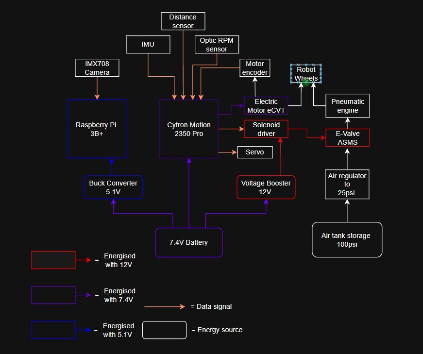

# Mechanical

### The Pneumatic Engine

Our robot uses a 4 piston, 2 [*crankshaft*](Glossary.md) pneumatic engine. It has a [*flywheel*](Glossary.md) that smoothes out how the engine spins with [*inertia*](Glossary.md), we made it with slots in order to count the interruptions per second with the [*Photointeruptor*](Glossary.md) RPM sensor, which lets us know how fast its going **(more on that later)**.

[**Click here to understand engine fundamentals**](mechanical\Pneumatics\Penumatic_Engine\README.md)

[**Click here to see past iterations of the engine**](mechanical/Pneumatics/Penumatic_Engine)

<table>
  <tr>
    <td>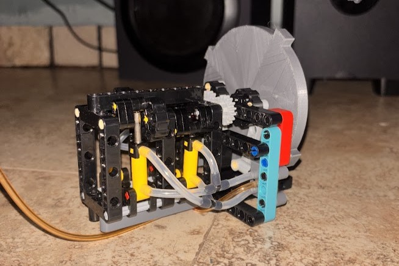</td>
    <td>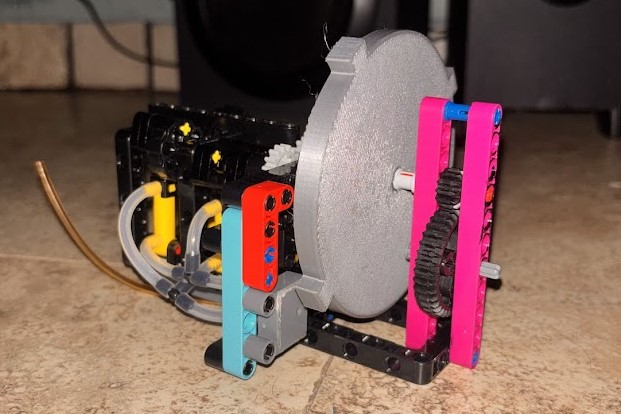</td>
  </tr>
  <tr>
    <td align="center">Front view</td>
    <td align="center">Back view</td>
  </tr>
</table>

From the output of the flwyheel, to the output of the pneumatic engine we used a 1.4:1 gear ratio, [**click here to see why we chose this**](development_process/tests/engine_output_ratios.md).

### A.S.M.S (Air Supply and Management System)
The ASMS stores compressed air in a tank assembly with a combined internal [*displacement*](Glossary.md) of 1,422 cm³, charged to 100 [*psi*](Glossary.md). A pressure regulator reduces the stored air pressure to a nominal operating pressure of 20 psi before supplying the pneumatic engine. Storing the air at a higher pressure was escential for a longer runtime [click here to see how we tested that](development_process/tests/air_supply_duration_calculations.md).

 A normally closed, electronic valve controls air delivery to the engine, remaining closed until electrically energized by the robot's control system.

 

</td>
</tr>
</table><table>
<tr>
<td width="50%" align="center">

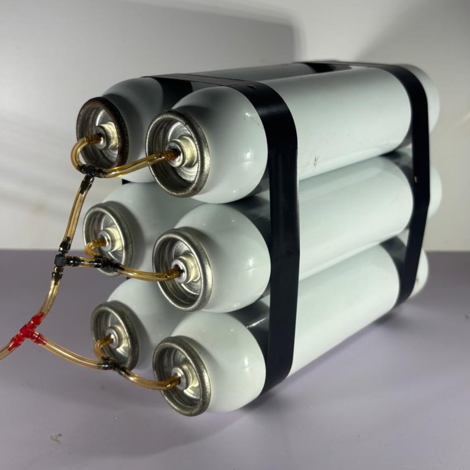

</td>
<td width="60%" valign="top">

We store the compressed air in 6 lightweight tanks at 100psi of pressure, and join them all with silicone tubing and "T" adapters.

[why we used it and more details here.](mechanical/eCVT/README.md)
</td>
</tr>
</table>

### Pneumatic System Pressure Ratings and Safety Margins

| Component | Maximum Rated Pressure (PSI) | Operating Pressure (PSI) | Safety Margin (PSI) |
|:--|--:|--:|--:|
| Pneumatic Air Tanks | 110 | 100 | 10 |
| Pressure Regulator | 145 | 25 | 120 |
| Pneumatic Engine (Low Pressure Hoses) | 40 | 25 | 15 |
| E-Valve  | 115 | 25 | 90 |
| NPT M¼ to NPT F⅛  brass fitting | 1200 | 100 | 1100 |
| NPT M¼ to NPT M⅛ | 1200 | 100 | 1100 |
| Brass T fitting, 2x F⅛, 1x M⅛| 1200 | 100 | 1100 |
| NPT M⅛ to ¹⁄₁₆ hose barb| 120 | 100 | 20 |
| NPT M⅛ schrader valve| 200 | 100 | 100 |
| High pressure hoses and conectors| 120 | 100 | 20 |

Note that the manufacturer's max pressure isn't the [*burst pressure*](Glossary.md), they normally have some headroom before a total failure, so safety the safety margin is actually more.

## The challenges of a pneumatic engine in a autonomous robot
A conventional electric drivetrain is simpler, more efficient, easier to control, and generally better suited for an autonomous competition robot than a penumatic engine. Rather than treating the disadvantages of pneumatic power as reasons to avoid it, we treated them as engineering challenges.

But we knew that the limitations of a pneumatic drivetrain were not necessarily limitations of the pneumatic engine alone, but of how the entire drivetrain was designed around it.

<table>
<tr>
<th width="50%">Disadvantage</th>
<th width="50%">Our Approach</th>
</tr>

<tr>
<td>Hard to control the pneumatic engine's speed with a reliable, leak free, compact, and lightweight solution.</td>
<td>An eCVT allows you to keep the pneumatic engine on a fuel eficient speed while changing the speed of the robot with the secondary electric motor.

[**Click here to see how we proved this with our own custom engine dyno**](development_process/tests/DYNAMOMETER.md)</td>
</tr>

<tr>
<td>A system capable of continuously supplying compressed air to the pneumatic engine would be expensive, heavy, and consume valuable space on the robot.</td>
<td>Rather than supplying compressed air continuously, we designed the robot around stored compressed air using lightweight, high pressure tanks and a way to regulate the air, allowing the pneumatic engine to operate independently of an onboard compressor.</td>
</tr>

<tr>
<td> Pneumatic engine can only spin a certain direction, depending of how timing is set up.  </td>
<td>Instead of reversing the pneumatic engine, we designed the drivetrain so that reverse motion is handled electrically through the eCVT. This allows the pneumatic engine to remain optimized for forward operation while maintaining bidirectional control of the robot.</td>
</tr>

</table>

### The eCVT 5.1

</td>
</tr>
</table><table>
<tr>
<td width="50%" align="center">

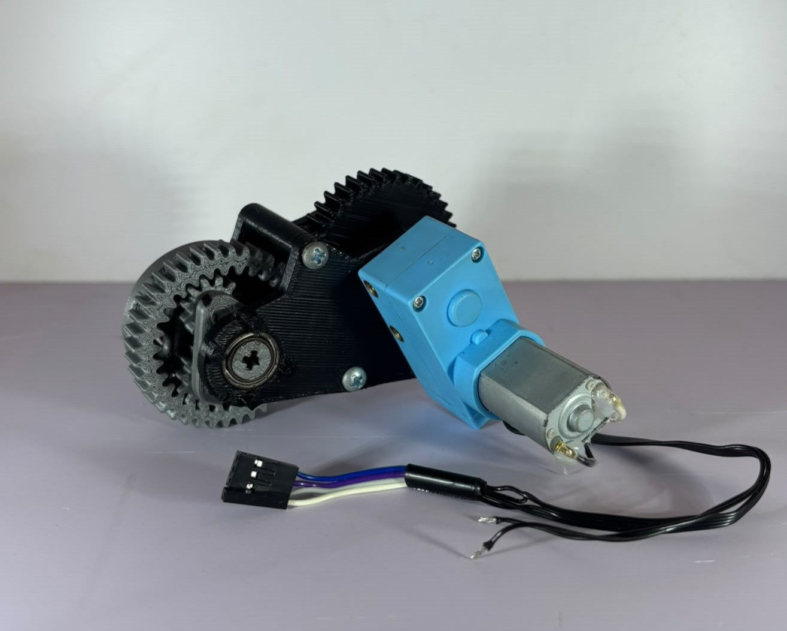

</td>
<td width="60%" valign="top">

An **eCVT** is a electronic continuosly variable transmission, a transmission that pairs two inputs in to a output, and with the proper combining of the inputs, a output with an infinite [*gear ratio*](Glossary.md) is possible without the need of gear shifting. 

[Click here to see why we used it](mechanical/eCVT/README.md)

[See the past iterations of the eCVT!](mechanical\eCVT)
</td>
</tr>
</table>

</td>
</tr>
</table><table>
<tr>
<td width="50%" align="center">

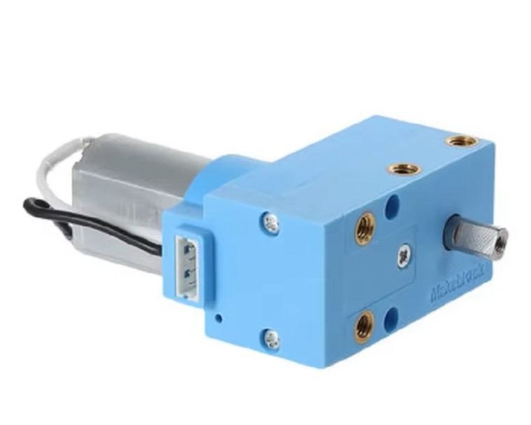

</td>
<td width="60%" valign="top">

The second input for the eCVT is this, a makeblock 7.4V Motor with a built in encoder, this allows us to know precisely at what RPM its spining, which is escential for eCVT logic.

[More on calculated gear ratios on software.]()

</td>
</tr>
</table>

# Dynamometer

Since one of the best features of our custom eCVT is the ability to keep the pneumatic engine on a fuel eficient speed while changing the speed of the robot with the secondary electric motor, we needed to know which was the most eficient speed of the pneumatic engine.

We built a custom dynamometer to measure the engine's [*torque*](Glossary.md), [*rotational speed*](Glossary.md), and [*horsepower*](Glossary.md) at different regulator operating pressures. This allowed us to evaluate the trade-off between engine performance and air consumption.

 

<table>
  <tr>
    <td width="40%" valign="top">
      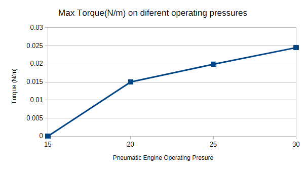
    </td>
    <td width="60%" valign="top">
      <h3>Max Torque</h3>
      

        A load cell measures the reaction force generated by the
        braking mechanism, allowing torque to be calculated.
      

    </td>
  </tr>
    <tr>
    <td width="40%" valign="top">
      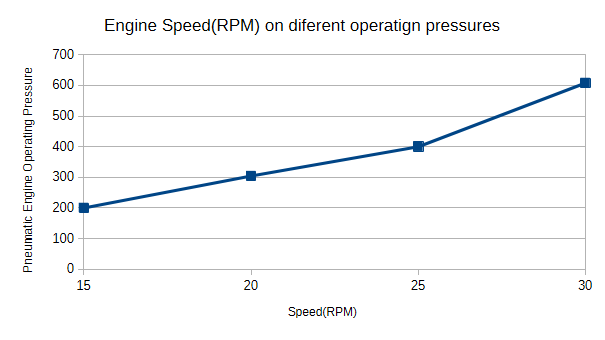
    </td>
    <td width="60%" valign="top">
      <h3>Max RPM</h3>
      

        An optical sensor tracks the engine's rotational speed
        throughout the testing process.
      

    </td>
  <tr>
    <td width="60%" valign="top">
      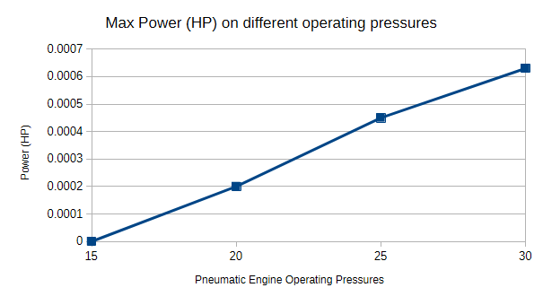
    </td>
    <td width="40%" valign="top">
      <h3>Max Power</h3>
      

        With the calculated torque, and the RPM of the engine, we calculated the power.
      

    </td>
  </tr>
  </tr>
    <tr>
    <td width="60%" valign="top">
      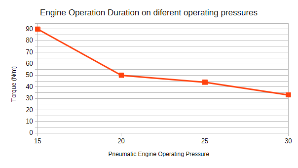
    </td>
    <td width="40%" valign="top">
      <h3>Operation Duration</h3>
      

        This chart represents how the air supply duration is affected by the operating air pressure.
      

    </td>
    
  </tr>
</table>

### Selecting the optimal operating pressure

| Pressure | Advantages | Disadvantages | Trade-off |
|---|---|---|---|
| **15 PSI** | Low air consumption | Low rotational speed, torque and power could not be measured | Greater potential endurance, but very limited performance |
| **20 PSI** | Measurable torque and power moderate operating pressure | Lower maximum output than higher-pressure settings | Sacrifices peak performance in favor of a more longer runtime |
| **25 PSI** | Higher torque, power, and speed than at 20 PSI | Greater air consumption and reduced runtime | Improved performance at the expense of air endurance |
| **30 PSI** | Highest measured torque, power, and rotational speed | Higher air consumption and shorter runtime | Maximizes instantaneous performance rather than endurance |

### Selected operating pressure: **20 PSI**

Although 30 PSI provided the highest measured power output, we selected 20 PSI to prioritize air endurance over maximum instantaneous performance. This provides a compromise between mechanical output and the available compressed-air supply.
The data shows a fairly clear trend: increasing pressure improves the pneumatic engine's performance, but it comes at the cost of operating duration. That's a  trade-off to discuss because we're not simply trying to maximize power, we're balancing performance against available stored energy.

### Dyno results at 20psi

|  | 20 PSI |
|---|---|
| Maximum Torque | 0.015 N·m |
| Maximum Power | 0.0002 HP |
| Maximum Speed | 304 RPM |
| No-Load Runtime | 50 s |

# Electrical

Our robot's components need 3 different voltages.

- 7.4V - supplied by two 3.7V batteries in series.
- 5V - supplied by a buck converter that lowers the voltage from 7.4V to 5V
- 12V - supplied by the voltage booster  

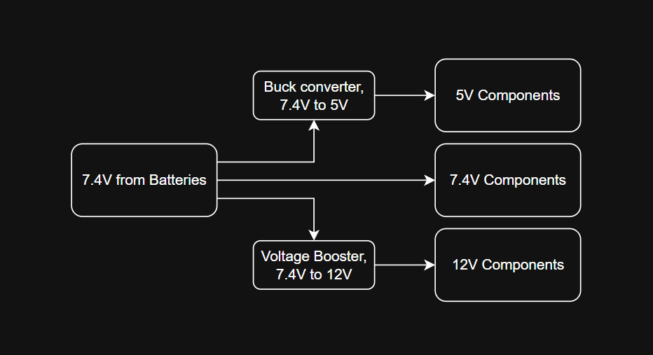

### Max current calculations

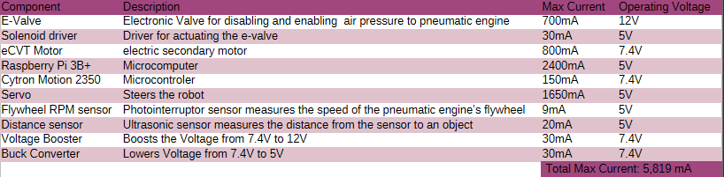

The robot uses interchangeable 7.4 V battery packs with a nominal capacity of 3.5 [*Ah*](Glossary.md). Due to the robot's limited mass and available space, additional onboard battery capacity is not practical within the current design constraints. Instead, packs are swapped and recharged between runs.

### [*Solenoid*](Glossary.md) Driver

Our ASMS uses a e-valve to open or close the passage of air pressure to the pneumatic engine. To supply the 800mA and 12V it needs we needed to make a driver board for it.

</td>
</tr>
</table><table>
<tr>
<td width="50%" align="center">

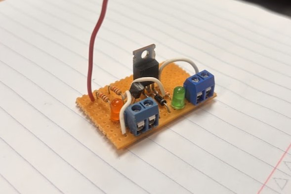

</td>
<td width="60%" valign="top">

The solenoid driver uses a MOSFET in order to control a high current circuit with a small current circuit.

Since we used a MOSFET that wasnt logic level, we also used a gate driver, to fully close the MOSFET when the signal is HIGH, two LED to indicate the state and a diode for safety purposes.

[More details here.](electrical/Cytron_Motion_2350_Pro/Solenoid_driver/README.md)

</td>
</tr>
</table>

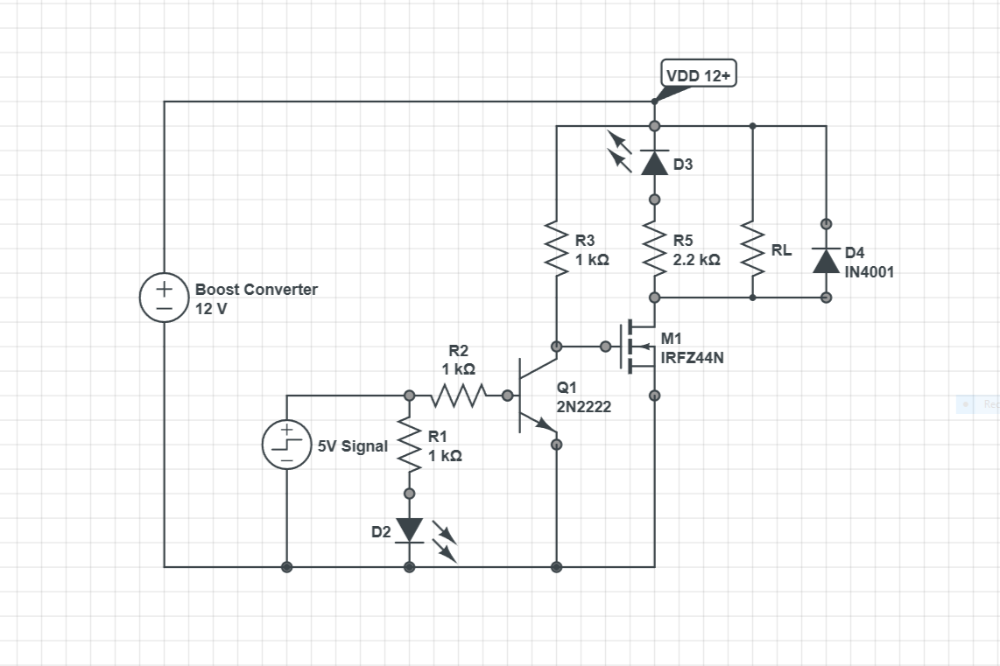

The Mosfet driver Circuit electrical diagram.

# Software and Sensors

AIZA uses two controllers, a **Cytron Motion 2350 Pro** and a **Raspberry Pi 3B+**, each responsible for a different part of the robot's operation. This separation allows the Raspberry Pi to handle computationally intensive vision processing while the Cytron manages real-time drivetrain control, sensor acquisition, and actuators.

The two controllers communicate through a [*UART*](Glossary.md) connection. The Raspberry Pi processes camera information and determines the robot's navigation commands, while the Cytron handles the drivetrain response using feedback from the IMU, distance sensor, and rotary encoders.

## System Architecture

| Controller | Main responsibilities |
|---|---|
| Raspberry Pi 3B+ | Camera image processing, navigation decisions, and sending movement commands |
| Cytron Motion 2350 Pro | Transmission control, motor actuation, RPM measurement, IMU and distance sensor readings, and communication with the Raspberry Pi |

### UART Communication

The Raspberry Pi and Cytron exchange information through a 3.3 V UART connection. This allows the Raspberry Pi to send movement commands while receiving sensor information from the Cytron.

[See the UART test log here](development_process/tests/UART.md)

## Cytron Motion 2350 Pro

The Cytron is responsible for the drivetrain's low-level control and sensor acquisition. It reads the IMU and distance sensor and communicates their measurements to the Raspberry Pi. It also handles the startup handshake between both controllers.

Its most important task is controlling the eCVT's electric input.

### eCVT Control Logic

The transmission has two inputs: the pneumatic engine and an electric motor. The pneumatic engine's rotational speed is measured using a photointerrupter sensor positioned next to the slotted flywheel. The electric motor has an integrated encoder that provides feedback about its rotational speed.

The Cytron uses these measurements to regulate the electric motor toward a target RPM. The target depends on the movement command received from the Raspberry Pi.

By controlling the electric input relative to the pneumatic engine's speed, the controller changes the combined output of the [*planetary transmission*](Glossary.md). This allows the robot's wheel speed to be controlled while maintaining a fuel efficient speed on the pneumatic engine.

[Click to see initial test of the eCVT logic.](development_process/tests/eCVT%20logic%20coding.md)

### Pneumatic Engine RPM Measurement

The pneumatic engine's speed is measured using a photointerrupter and a slotted disk attached to the flywheel.

Every time a slot passes through the sensor, the optical path is interrupted, producing a pulse. The Cytron measures the time between consecutive pulses and uses the known number of slots per revolution to calculate RPM.

[Flywheel RPM sensor development](development_process/tests/Flywheelencoder.md)

### Why an optical sensor instead of a Hall-effect sensor?

A Hall-effect sensor detects changes in a magnetic field, usually by sensing a magnet attached to the rotating component. An optical photointerrupter instead detects interruptions in a light path.

[See why we chose the photointerruptor](development_process\logs\Hallvsoptic.md)

## Raspberry Pi 3B+

The Raspberry Pi is responsible for vision processing and high-level navigation decisions. It receives images from the IMX708 camera, processes the field markings, and determines the direction and speed commands required to navigate the competition field.

The Raspberry Pi sends the Cytron the movement commands through UART, including direction and speed information. It also participates in the startup handshake.

### Camera and Image Processing

The IMX708 camera captures images at 2304 × 1296 pixels, while the preview is displayed at 640 × 360 pixels to reduce the processing required for visualization.

<table>
  <tr>
    <td></td>
    <td></td>
  </tr>
  <tr>
    <td align="center">IMX708 120° FOV</td>
    <td align="center">OV5647 56° FOV</td>
  </tr>
</table>

We started with the OV5647 but we soon realized that we were missing on a lot of valueable information of the walls of the playfield, so we upgraded to the IMX708.

[IMX708 specs](electrical/Raspberry_π_3B+/Camera/IMX708.md)

The image-processing pipeline was developed to identify the boundaries of the drivable field and the colored lines used for navigation.

The main processing stages are:

1. **Field segmentation:** Convert the image to grayscale and apply a threshold to distinguish the white drivable area from the black surrounding boundaries.
2. **Contour extraction:** Use OpenCV contour detection to identify the field's outline.
3. **Boundary processing:** Identify useful black-to-white transitions and approximate the field boundaries using contour processing and line fitting.
4. **Color detection:** Convert the filtered image to [*HSV*](Glossary.md) and apply color thresholds to isolate the blue and orange markings.
5. **Navigation input:** Use the detected markings and their positions in the image to determine the next navigation action.

The HSV thresholds were established by sampling the colors as they appeared through the actual camera, rather than relying exclusively on the official field color values. This was important because camera readings can vary with lighting conditions.

[Click here to see how the camera processes the field geometry](development_process/tests/matthreshholddetecting.md)

# Strategy

## Before Starting

The robot uses a main power switch and a separate onboard button to initiate its autonomous program.

After the main power switch is activated:

1. Both controllers power on and initialize their respective hardware.
2. The Cytron initializes UART communication and waits for the Raspberry Pi to finish booting.
3. Once initialized, the Raspberry Pi sends a `Ready` signal to indicate that it is prepared to communicate.
4. The Cytron waits for the operator to press the onboard start button.
5. When the button is pressed, the Cytron sends a `Start` command to the Raspberry Pi.
6. The Raspberry Pi initializes the vision program and resets the yaw reference to zero.

This sequence separates powering the robot from initiating autonomous operation, allowing the controllers and sensors to initialize before movement begins.

## Navigation State Machine

The navigation state machine runs on the Raspberry Pi and uses the camera to identify the colored lines and black boundaries on the competition mat.

The detected blue and orange markings provide information about the robot's position and the direction it must take at intersections. The order in which these markings are detected is used to determine the next navigation action.

The camera processing also tracks the position and apparent length of the detected line in the image. This information is used to determine when the robot is approaching a turning point.

The Raspberry Pi uses this information, together with the IMU's yaw measurement, to decide when to initiate and complete a turn.

## Speed State Machine and Transmission Control

The navigation state machine determines the required movement, while the speed state machine translates that decision into a speed command for the Cytron.

The Raspberry Pi sends a speed value from 1 to 7. The Cytron interprets this command and uses the pneumatic engine flywheel RPM and electric motor encoder feedback to regulate the eCVT's electric input.

This separates high-level navigation decisions from low-level transmission control:

- **Raspberry Pi:** Determines where the robot should go and the movement command required.
- **Cytron:** Determines how to control the electric transmission motor to achieve the commanded movement.

This division also allows the transmission controller to continuously respond to engine-speed changes without requiring the Raspberry Pi to perform the low-level motor regulation.

## Open Challenge Navigation Sequence

After receiving the `Start` command, the Raspberry Pi begins the vision-based navigation program.

The robot initially moves forward. The camera-processing algorithm traces a reference line starting from the bottom-center region of the image and searches for the blue or orange field markings.

When a marking is detected, the program records which color was encountered first and tracks its apparent length in pixels.

As the robot approaches the turning point, the detected line length decreases. When it falls below the 50-pixel threshold, the program records the current yaw angle and initiates the turn.

During the turn, the IMU provides the robot's orientation relative to the recorded yaw reference. Once the measured angular displacement exceeds 90°, the program recenters the robot and resumes straight-line navigation.

This sequence is repeated 11 times to complete the Open Challenge navigation route.

## Sensors and Feedback

| Sensor | Controller | Purpose |
|---|---|---|
| IMX708 camera | Raspberry Pi | Detects field boundaries and colored navigation markings |
| BNO085 IMU | Cytron | Measures orientation and yaw for turning and heading correction |
| Ultrasonic distance sensor | Cytron | Measures distance to nearby objects |
| Flywheel photointerrupter | Cytron | Measures pneumatic engine RPM |
| Electric motor encoder | Cytron | Measures transmission motor rotation and RPM |

The camera provides visual information for navigation, while the IMU and encoders provide feedback about the robot's orientation and drivetrain operation. The ultrasonic sensor supplies additional distance information.

