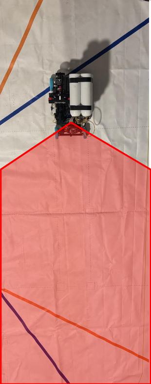
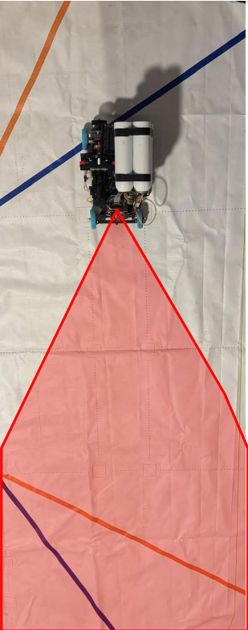

### Camera trade-offs
We initialy started using the OV5647, but we noticed that it missed out on a lot of valueable info due to its low FOV, we instead used the IMX708 which granted a big improvement of 120° of FOV.

<table>
  <tr>
    <td align="center"> IMX708  120° </td>
    <td align="center"> OV5647  56° </td>
  </tr>
  <tr>
    <td></td>
    <td></td>
  </tr>
</table>

[IMX708 specs](electrical/IMX708.md)

[OV5647 specs](electrical/OV5647.md)
