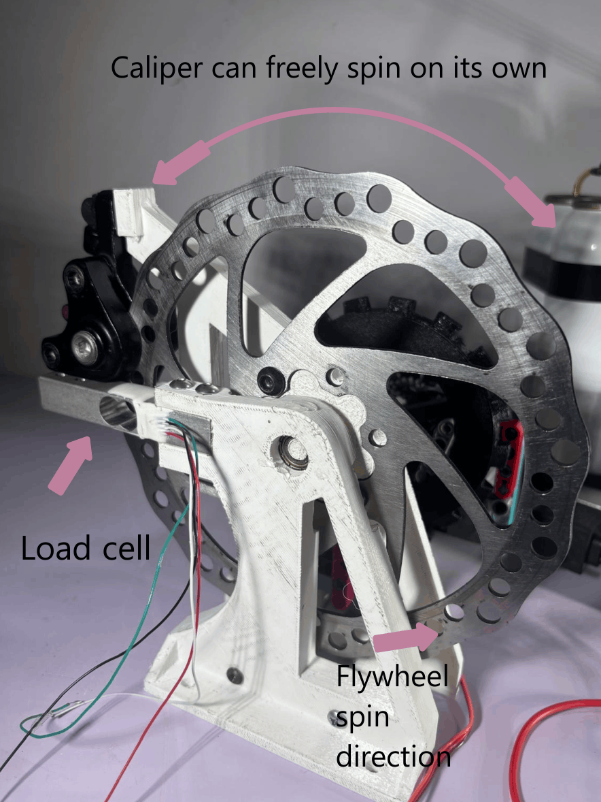
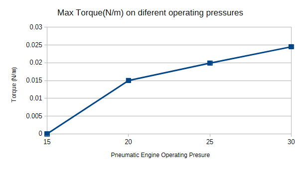
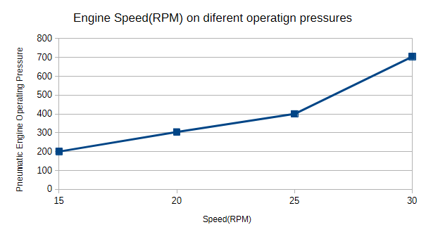
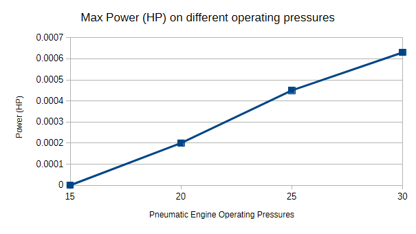
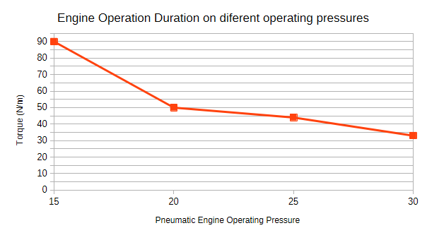

# Compressed air consumtion and eficiency measured by our dynamometer

## Overview

### What is a Dynamometer?
A dynamometer often refered as a "dyno" measures the rotational force on a axle, this can be used to measure torque, and with that, power. 

The system uses a mechanically adjustable braking mechanism and a strain-gauge load cell to measure reaction force, allowing torque and mechanical power to be calculated under different operating pressures.

The primary objectives are:

- Determine maximum engine torque and power.
- Evaluate the trade-offs between operating pressure and engine performance to determine at what operating presure the engine is most eficient.

### Dynamometer Design

</td>
</tr>
</table><table>
<tr>
<td width="50%" align="center">

</td>
<td width="60%" valign="top">

We used a Bicycle brake disc as the flywheel, and its brake disc on a torque arm that can freely spin on the axle of the flywheel. When the test is iniciated and the flywheel spins, the caliper is slowly applied until the engine stalls, the reaction force of the flywheel is slowly transfered to the caliper which also apllies to the load cell, the load cell gives us a force reading based on that reaction force.

▶️[Watch a real test in process!](https://www.youtube.com/watch?v=zN0mTRjt_Ns)

</td>
</tr>
</table>

## Results

| Pressure (PSI) | Max Torque average (N·m) | Max Power average (HP) | Max Speed (RPM) | No-Load Runtime (s) |
|---:|---:|---:|---:|---:|
| 15 | (unmeasurable) | (unmeasurable) | 60 | - |
| 20 | 0.015N·m | 0.0002HP | 304RPM | 47s |
| 25 | 0.0199N·m | 0.00043HP | 400RPM | — |
| 30 | 0.0245N·m | 0.00063HP | 608RM | — |

 
<table>
  <tr>
    <td width="40%" valign="top">
      
    </td>
    <td width="60%" valign="top">
      <h3>Max Torque</h3>
      

        A load cell measures the reaction force generated by the
        braking mechanism, allowing torque to be calculated.
      

    </td>
  </tr>
    <tr>
    <td width="40%" valign="top">
      
    </td>
    <td width="60%" valign="top">
      <h3>Max RPM</h3>
      

        An optical sensor tracks the engine's rotational speed
        throughout the testing process.
      

    </td>
  <tr>
    <td width="60%" valign="top">
      
    </td>
    <td width="40%" valign="top">
      <h3>Max Power</h3>
      

        With the calculated torque, and the RPM of the engine, we calculated the power.
      

    </td>
  </tr>

  </tr>
    <tr>
    <td width="60%" valign="top">
      
    </td>
    <td width="40%" valign="top">
      <h3>Operation Duration</h3>
      

        This chart represents how the air supply duration is affected by the operating air pressure.
      

    </td>
    
  </tr>
</table>

### Selecting the optimal operating pressure

| Pressure | Advantages | Disadvantages | Trade-off |
|---|---|---|---|
| **15 PSI** | Low pressure demand and low air consumption | Low rotational speed; torque and power could not be measured | Greater potential endurance, but limited demonstrated performance |
| **20 PSI** | Measurable torque and power; moderate operating pressure | Lower maximum output than higher-pressure settings | Sacrifices peak performance in favor of a more longer runtime |
| **25 PSI** | Higher torque, power, and speed than at 20 PSI | Potentially greater air consumption and reduced runtime | Improved performance at the expense of air endurance |
| **30 PSI** | Highest measured torque, power, and rotational speed | Higher air consumption and shorter runtime | Maximizes instantaneous performance rather than endurance |

**Selected operating pressure: 20 PSI**

Although 30 PSI provided the highest measured power output, we selected 20 PSI to prioritize air endurance over maximum instantaneous performance. This provides a compromise between mechanical output and the available compressed-air supply.
The data shows a fairly clear trend: increasing pressure improves the pneumatic engine's performance, but it comes at the cost of operating duration. That's a  trade-off to discuss because we're not simply trying to maximize power, we're balancing performance against available stored energy.

## How does the dyno work?
### Steps to test 

Each test follows the same sequence:

1. Presureize the system with air
2. Set the pneumatic regulator to the desired operating pressure.
3. Capture the unloaded load-cell reading.
4. Calibrate using the 26 g reference mass.
5. Remove the reference mass.
6. Install the caliper and capture its tare reading.
7. Activate the pneumatic engine.
8. Gradually increase braking force.
9. Record engine RPM, reaction force, torque, and estimated power.
10. Continue until the engine stalls.
11. Repeat at different operating pressures.

No-load runtime is measured separately, with the engine operating without applied braking resistance.

### 1. Calibration Procedure
---

The HX711's output is a number that we called "counts" that increments with more force, a reference mass of 26 g is used to establish the load-cell conversion factor.

The calibration sequence consists of:

1. Measuring the unloaded load-cell count output.
2. Placing the 26 g reference mass.
3. Measuring the loaded counts output.
4. Calculating the conversion factor in counts per gram.
5. Removing the reference mass.
6. Installing the brake caliper and capturing a new zero offset.

The calibration factor is calculated as:

$$
C_g = \frac{|R_{26g}-R_0|}{26}
$$

Where:

- $C_g$ = Calibration factor (counts/g).
- $R_{26g}$ = Reading with the reference mass.
- $R_0$ = Unloaded reading.
### 2. Starting the test
---
Once calibrated, the program commands the solenoid driver to turn on, once the engine spins, the user must apply the brake slowly until the engine stalls.

Since the caliper wants to go with the flywheel when its engaged, the force of the flywheel is tranlated to the load cell, where it will be outputted as a signal for the microcontroller to use.

### 3. Calculating Torque and Power
---

### Reaction Force
The load-cell reading is converted into force using the calibration factor:

$$
F = \frac{|R-R_{tare}|}{C_g}
\times \frac{9.81}{1000}
$$

Where:

- $F$ = Reaction force (N).
- $R$ = Current load-cell reading.
- $R_{tare}$ = Caliper tare reading.
- $C_g$ = Calibration factor (counts/g).
---
### Dynamometer Torque

The formula for torque, measured in the dyno.

$$
T_{dyno}=F \times 0.100
$$
---
### Engine Torque

Since we have a 3:1 gear ratio, the torque gets multiplied by 3, to have the torque actually produced by the engine we need to divide it by 3.

$$
T_{engine}=\frac{T_{dyno}}{3}
$$

---
### Mechanical Power

Engine rotational speed is measured directly by the optical sensor.

$$
P=T_{engine}\times\frac{2\pi RPM}{60}
$$

Horsepower is calculated as:

$$
HP=\frac{P}{745.7}
$$

Maximum torque and maximum power are recorded independently because they do not necessarily occur at the same rotational speed.

---
### Measurement Limitations

Since the dynamometer's method of measuring torque is by braking, when the engine has a null amount of torque its dificult to have a good reading, thats why the 15psi row of samples is fuilled with "unmeasureable", it also makes it dificult to calculate transmission eficiency, energy loss due to frictin in gears. 

---
### Software 

The dynamometer control program:

- [Dynamometer Control Code](../../media/srs/Dyno.py)
