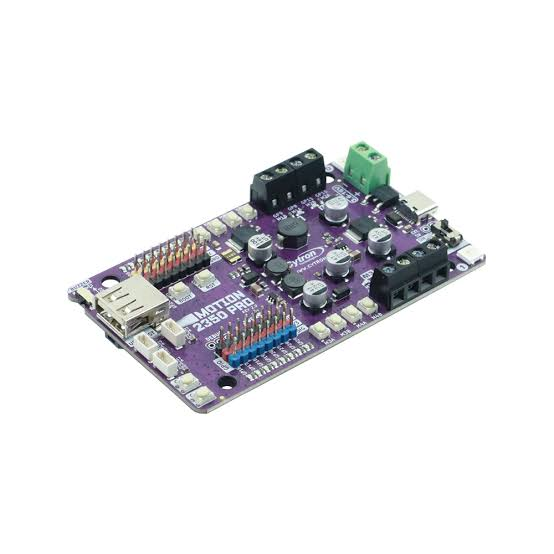

## Cytron Motion 2350 Pro

The Cytron Motion 2350 Pro serves as AIZA's low-level control unit. It handles drivetrain actuation, eCVT control, encoder-based RPM measurements, and communication with the Raspberry Pi 3B+.

It reads data from the BNO085 IMU and ultrasonic distance sensor, monitors the pneumatic engine's flywheel RPM through a photointerrupter, and uses the electric motor's encoder to regulate the eCVT's electric input.

The Cytron communicates with the Raspberry Pi through UART, receiving movement commands and transmitting sensor measurements and controller status.

This directory contains the firmware, hardware configuration, and supporting code used by the Cytron Motion 2350 Pro in the WRO Future Engineers 2026 robot.