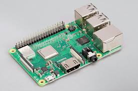

### Raspberry Pi 3B+

Handles computer vision and autonomous navigation. Processes camera images, detects field markings and obstacles, determines the robot's navigation decisions, and communicates movement commands to the Cytron controller through UART.