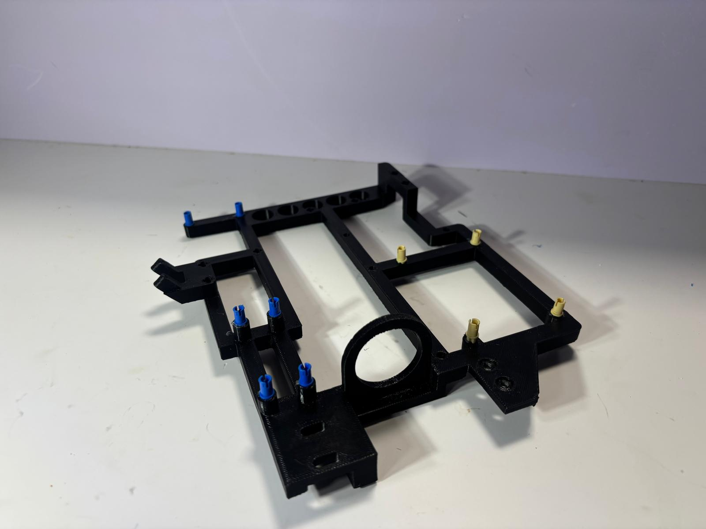

## Chassis V.4 Design

The chassis is the fourth iteration, it serves as the structural foundation of AIZA, supporting the drivetrain, steering mechanism, pneumatic system, electronics, and sensors. Its design must accommodate the robot's mechanical and electrical components while maintaining sufficient rigidity and stability for autonomous operation.

### Design Considerations

Several factors influenced the chassis design:

- **Component integration:** Provide mounting locations for the pneumatic engine, eCVT, differential, steering mechanism, air tanks, batteries, and controllers.
- **Weight distribution:** Position components to distribute mass appropriately and avoid unnecessarily concentrating weight on one side of the vehicle.
- **Structural rigidity:** Minimize chassis deformation under drivetrain loads, steering forces, and the weight of the pneumatic system.
- **Packaging constraints:** Fit all components within the competition's dimensional restrictions while maintaining accessibility for assembly and maintenance.
- **Serviceability:** Allow components to be removed, adjusted, or replaced without requiring extensive disassembly of the robot.
- **Sensor positioning:** Provide stable mounting locations that preserve the camera's field of view and the orientation of other sensors.

### Design Trade-offs

| Design consideration | Benefit | Trade-off |
|---|---|---|
| Structural rigidity | Maintains component alignment and reduces deformation | Can increase material usage and weight |
| Compact component layout | Reduces packaging space and keeps the robot within dimensional limits | Can make maintenance and assembly more difficult |
| Accessible mounting points | Simplifies maintenance and component replacement | May require additional space |
| Centralized component placement | Can improve weight distribution | May complicate component access and packaging |
| Modular mounting | Allows individual subsystems to be removed or modified | Can introduce additional fasteners and structural interfaces |

### Assembly and Reproducibility

The chassis manufacturing files and assembly instructions are provided in the repository:

- [Mechanical CAD files](../media/CAD/STL/Car_Frame_3.stl)
- [Vehicle iterations](../development_process/vehicle_iterations)

