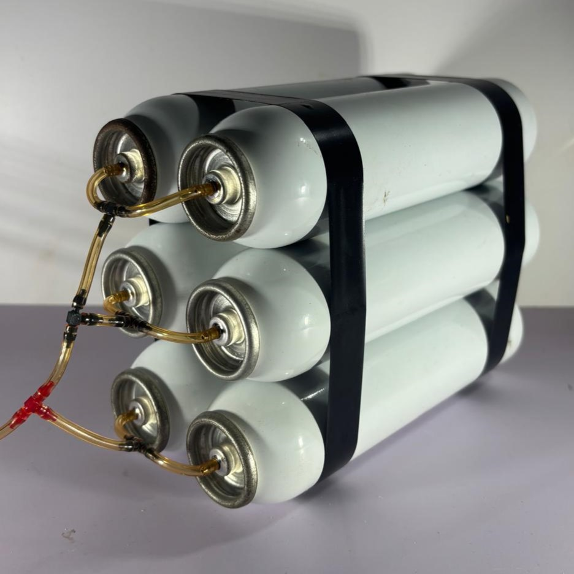
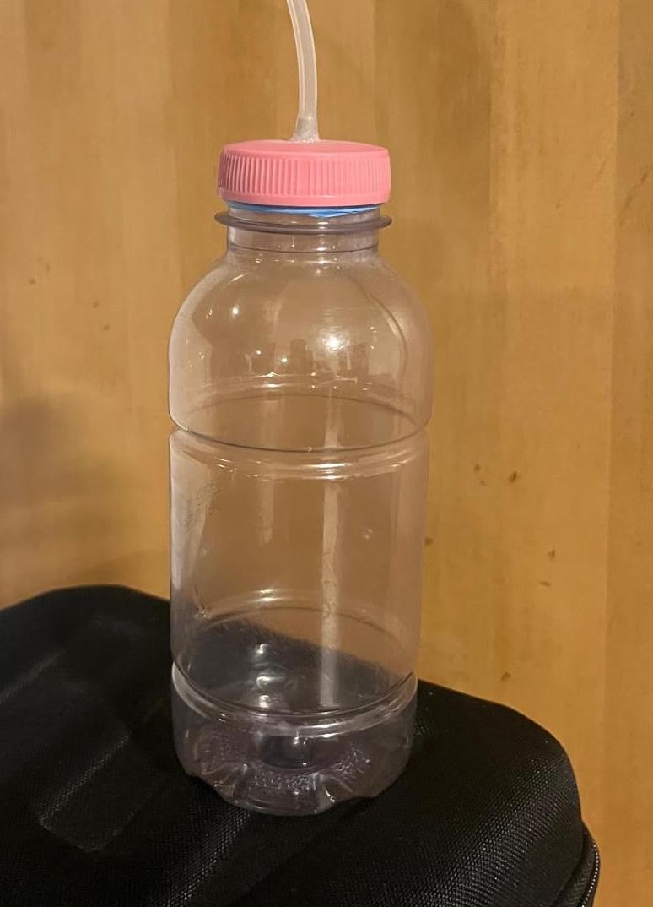

### Air tanks

We use Robart Small Air tanks, these can handle safely up to 115psi. Because of [this test](development_process/tests/air_supply_duration_calculations.md), we knew that we needed to store compressed air up to 100psi on the tanks, so we picked those one out of a rc airplane pneumatic manufacturer.

### First Air tanks

To make our proof of concepts our first air tanks were recicled plastic beverage with tephlon tape on the cap, and a hose sticking out of the bottle to connect to the engine.