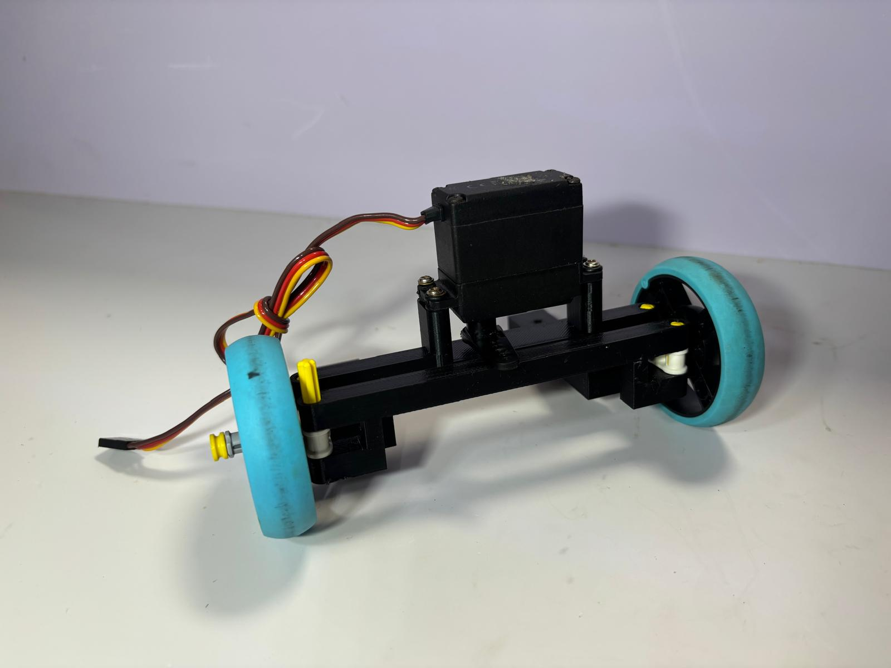

# Steering Geometry

## Overview

AIZA uses a parallel steering configuration rather than conventional Ackermann steering. The front wheels are connected through a linkage designed to make both wheels turn in the same direction and at approximately the same steering angle.

We thought simplicity was important for reliability and eficiency.

## Steering Linkage

The steering mechanism uses a center link and a steering base of equal length. This arrangement is intended to maintain symmetrical movement across both front steering assemblies.

## Track Width

The chassis uses different track widths at the front and rear:

| Parameter | Dimension |
|---|---:|
| Front track width | 140 mm |
| Rear track width | 170 mm |
| Track width difference | 30 mm |

The front track is 30 mm narrower than the rear track, giving the chassis a tapered footprint when viewed from above.

## Design Considerations

**Advantages**
- Mechanically straightforward linkage.
- Synchronized steering movement between both front wheels.
- Symmetrical steering input.
- Fewer geometric adjustments than an Ackermann linkage.

**Trade-offs**
- Both front wheels follow approximately the same steering angle, rather than their individual ideal turning angles.
- The wheels may experience additional lateral tire scrub during tight turns.

