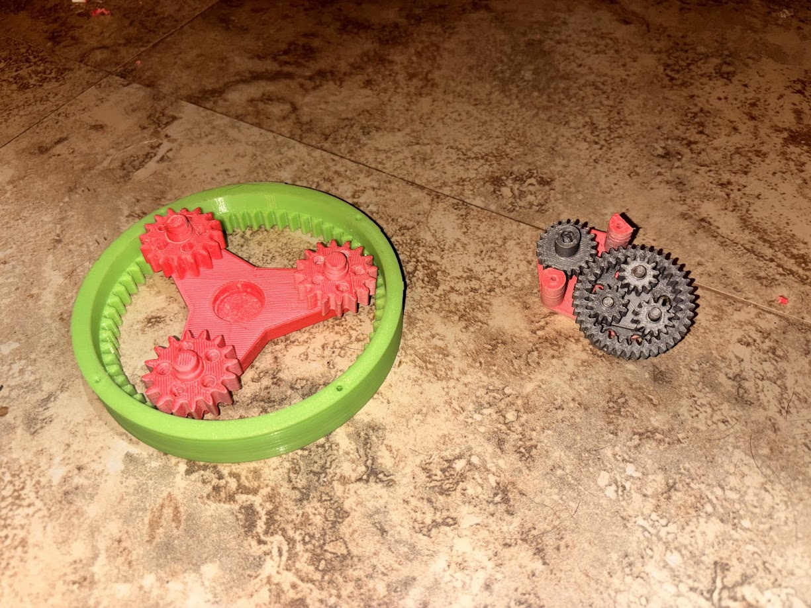

# eCVT 5.0
> Retrospective log from May 14, 2026: This entry's information was digitized from the physical engineering notebook.

eCVT 1.0 vs eCVT 5.0

## Specs
- Module: 1.15
- Pressure angle: 20°
- Gear ratio, 8.4 (Sun) : 1 (planet Carrier)
- Gear ratio, .833 (Ring Gear) : 1 (planet Carrier)
- R (Ring Gear) = 30
- S (Sun Gear) = 6
- P (Planet Gear) = 12
- OR (Outside Ring Gear) = 40

## Improvements

This version is the smallest, most lightweight and compact version yet, with a combination of reducing teeth count without altering gear ratios, and a smaller module on the gears we were able to make a transmission that was more than half the size of the past version and a fourth of the size of the first version.

On the PRNRO, we noticed that the car was escencially a tractor, it had a lot of torque and no speed, so we made the transmission motor a 2:1 ratio to the outside ring gear instead of a 4:1.

## Improvements proyected for the E-CVT 6.0

We think we have hit the limit of size, but we need to experiment more with gear ratios and calculate what we need for the final version.

# eCVT 5.1

eCVT 5.1

## Specs
- Module: 1.15
- Pressure angle: 20°
- Gear ratio, 8.4 (Sun) : 1 (planet Carrier)
- Gear ratio, .833 (Ring Gear) : 1 (planet Carrier)
- R (Ring Gear) = 30
- S (Sun Gear) = 6
- P (Planet Gear) = 12
- OR (Outside Ring Gear) = 40

This is the same as the 5.0, but with a 1:1 gear ratio from the electric motor to the ring gear, this almost doubled the max speed of the robot.

We shifted the motor a little bit because of clearance issues.

And we made a harnes with dupont connectors for the on board encoder.

